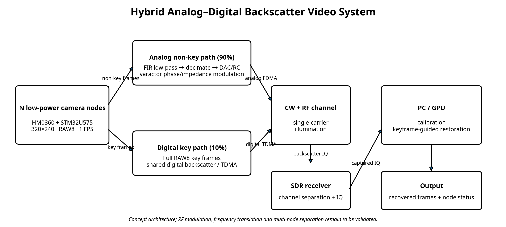
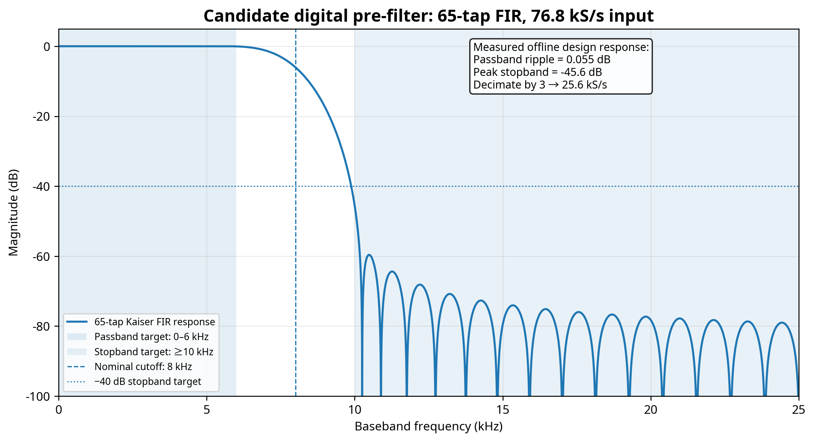
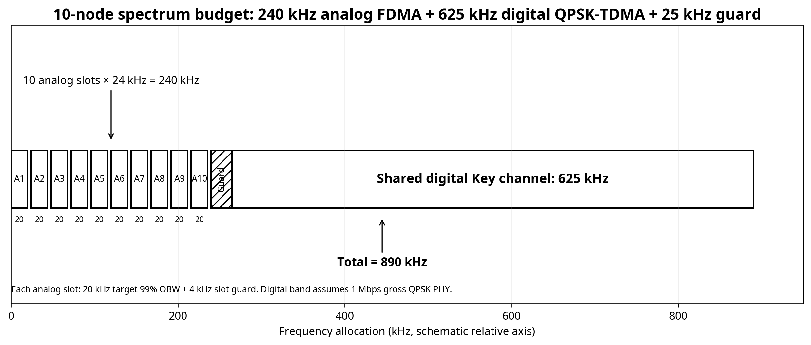
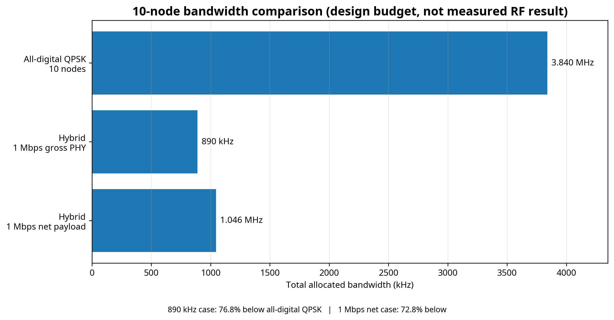
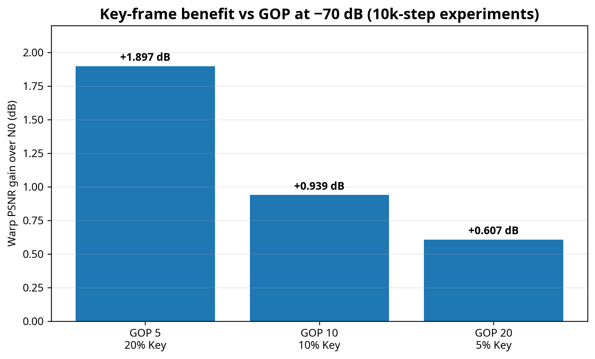
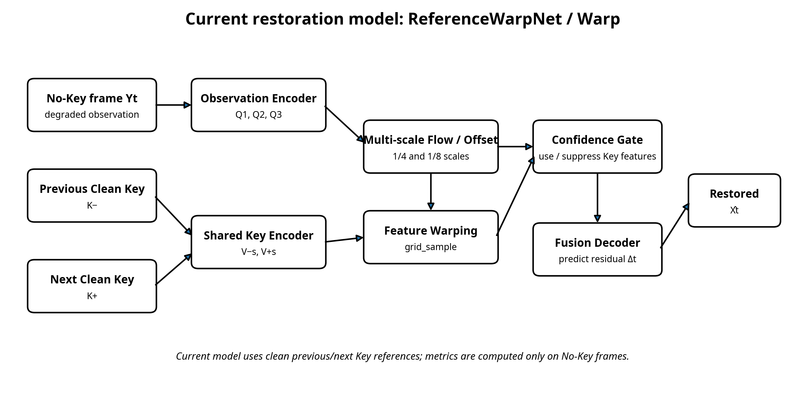
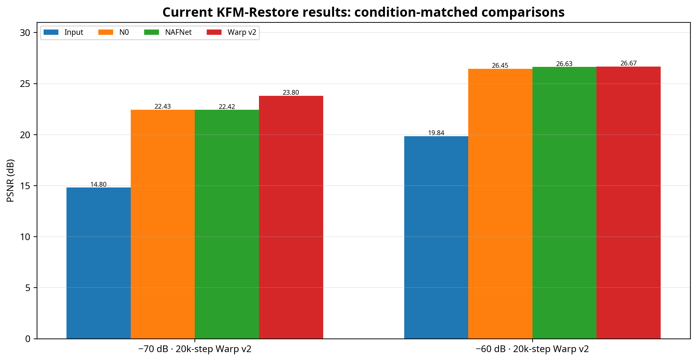
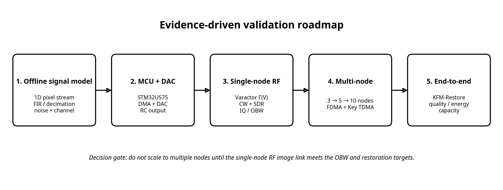

# 混合数字–模拟背散射视频传输：研究构想与当前进度

**版本：** v1.1（修复可查看版）  
**日期：** 2026-11-09  
**研究阶段：** 软件恢复已有实验结果；物理层参数已形成首版量化设计；真实 RF 链路和多节点系统尚未验证。

> **阅读说明**
>
> - **已验证结果**：来自当前 `PROJECT_SUMMARY.md`（2026-11-07），属于现有 KFM-Restore 数据集实验。
> - **理论计算**：由图像参数、调制方式和协议开销假设计算。
> - **设计目标**：建议用于第一轮硬件原型，不代表已经测得。
> - **待验证假设**：必须通过 DAC、Varactor、SDR 和多节点实验验证。
>
> 本文不把理论频谱预算写成实测结果，也不把现有数据集恢复结果等同于真实背散射链路结果。

------------------------------------------------------------------------

# 0. 一页概览：Idea、首版参数与当前进度

## 0.1 Research Idea

面向多个低功耗视觉节点，采用单载波激励的背散射方式传输低帧率视频：

1.  每个节点采集 320×240、RAW8、1 FPS 的黑白图像。
2.  大多数非关键帧经过数字低通滤波和抽取，再通过 DAC、无源重建滤波和变容二极管连续调制反射系数，以模拟方式传输。
3.  少量完整数字关键帧通过共享数字背散射信道分时传输。
4.  模拟非关键帧使用节点专属频移子带；数字关键帧使用共享 TDMA 时隙。
5.  接收端利用数字 Key 提供的清晰时序参考，结合低带宽模拟观测恢复非关键帧。

**核心研究问题：** 在相同恢复质量约束下，主动限制模拟视频带宽，并用稀疏数字 Key 补偿信息损失，能否降低多节点视觉传感网络的总频谱占用和节点能耗？

## 0.2 首版建议设计点

| 参数               |          首版数值          | 状态             |
|:-------------------|:--------------------------:|:-----------------|
| 摄像头             |      HM0360 黑白 CMOS      | 器件方案         |
| MCU                |         STM32U575          | 器件方案         |
| 分辨率             |          320×240           | 设计基线         |
| 帧率               |           1 FPS            | 设计基线         |
| 像素格式           |            RAW8            | 设计基线         |
| 原始像素速率       |         76.8 kS/s          | 计算值           |
| 原始图像数据率     |      614.4 kbps/node       | 计算值           |
| Key 策略           |      GOP=10，10% Key       | 首版策略         |
| 数字预滤波         | 65-tap FIR，名义截止 8 kHz | 离线候选设计     |
| FIR 输出采样率     |         25.6 kS/s          | 计算值           |
| 模拟 RF 99% OBW    |        ≤20 kHz/node        | **目标，未实测** |
| 模拟 FDMA 信道间隔 |        24 kHz/node         | **目标，未实测** |
| 数字 Key 通道      |   1 Mbps gross QPSK PHY    | 预算假设         |
| 接收端             |        SDR + PC/GPU        | 系统方案         |

## 0.3 最重要的量化结论

在 **10 个节点、GOP10、QPSK、滚降系数 0.25** 的预算条件下：

- 全数字原始视频：**3.84 MHz**
- 混合方案：**约 890 kHz**
- 理论频谱节省：**约 76.8%**
- 如果要求数字 Key 通道提供 1 Mbps 净载荷，混合预算约 **1.046 MHz**，节省约 **72.8%**。

**这两个节省比例是设计预算，不是已经测得的系统性能。** 其中最关键的前提是：模拟链路实际 99% OBW 能达到 20 kHz/node，并且频移结构能够实现节点间分离。

*图1：混合数字–模拟背散射系统总体架构*

## 0.4 当前进度

| 模块                       | 当前状态                     |
|:---------------------------|:-----------------------------|
| 低功耗摄像头与 MCU 选型    | 已有 HM0360 + STM32U575 方案 |
| KFM-Restore 恢复模型       | **已有多组数据集实验**       |
| GOP 与 Key 比例影响        | **已有 -70 dB 条件实验**     |
| 数字低通 + 抽取参数        | 已有离线候选设计             |
| DAC + RC 实际输出          | 尚未完成                     |
| Varactor 静态/动态 RF 特性 | 尚未完成                     |
| 单节点模拟背散射图像       | 尚未完成                     |
| 多节点 FDMA + Key TDMA     | 尚未完成                     |
| 频谱节省与能耗优势         | 目前为理论预算               |

------------------------------------------------------------------------

# 1. Research Draft：研究背景、动机与核心 Insight

## 1.1 Background

工业仪表、农业诱捕器、仓储货位、野外设施和分布式环境监测等场景，可能需要部署多个低帧率摄像头节点，并将图像集中传回一个接收终端。

这些场景通常具备：

- 节点分散，供电和布线不方便；
- 目标变化较慢，不要求传统 25/30 FPS 连续视频；
- 多节点同时传输原始图像时，频谱资源紧张；
- 节点侧算力和电池容量有限；
- 接收端可以集中使用 SDR、GPU 和较复杂的恢复算法。

本研究面向的是**多节点、低帧率、低功耗、关键帧驱动的视觉传感网络**，不是传统高清连续监控。

## 1.2 Motivation

320×240、RAW8、1 FPS 时，每个节点每秒产生 76,800 个像素，每个像素 8 bit：

$$
R_{\mathrm{pixel}}=320\times240\times1=76{,}800\ \mathrm{pixel/s}
$$

$$
R_{\mathrm{raw}}=76{,}800\times8=614.4\ \mathrm{kbps}
$$

10 个节点的原始数据率达到 6.144 Mbps。若直接使用低阶数字背散射调制，多个节点需要占用较宽的频谱。

另一方面，纯模拟背散射虽然可以避免逐像素 8-bit 符号传输，但会受到噪声、相位漂移、幅相非线性和像素间串扰影响。

## 1.3 Core Insight

本研究的核心不是单纯”模拟背散射传视频”，而是**主动控制模拟路径的信息损失，再由数字 Key 提供稀疏但可靠的参考信息**：

- 模拟路径：保留低频结构、亮度变化和当前动态，优先节省频谱。
- 数字路径：周期性发送完整 RAW8 Key，提供可靠细节和时序锚点。
- 接收端：用模拟观测确定当前帧状态，用数字 Key 补偿可迁移的细节。
- 网络层：模拟帧 FDMA，数字 Key TDMA。

核心假设：

$$
B_{\mathrm{analog}}\downarrow
\quad\Longrightarrow\quad
G_{\mathrm{key}}(B)\ \text{可能增加}
$$

其中：

$$
G_{\mathrm{key}}(B)
=Q_{\mathrm{with\ key}}(B)-Q_{\mathrm{without\ key}}(B)
$$

这一关系需要在不同滤波带宽下进行匹配训练和测试，不能预设必然单调成立。

------------------------------------------------------------------------

# 2. 物理层首版设计：只保留关键参数和计算结果

## 2.1 原始数字视频基线

设计参数：

| 参数             |              数值              |
|:-----------------|:------------------------------:|
| 图像尺寸         |            320×240             |
| 灰度位宽         |             8 bit              |
| 帧率             |             1 FPS              |
| 单帧像素数       |             76,800             |
| 单帧数据量       | 614,400 bit = 76.8 kB = 75 KiB |
| 每节点原始数据率 |           614.4 kbps           |

全数字 QPSK 基线采用升余弦成形，滚降系数 $\alpha=0.25$：

$$
B_{\mathrm{QPSK}}=(1+\alpha)R_s
=(1+\alpha)\frac{R_b}{2}
$$

单节点：

$$
B_{\mathrm{QPSK,node}}
=1.25\times\frac{614.4}{2}
=384\ \mathrm{kHz}
$$

10 节点：

$$
B_{\mathrm{digital,10}}=10\times384
=3.84\ \mathrm{MHz}
$$

这是未压缩 RAW8、无 FEC 和协议开销的 QPSK 理论基线。BPSK 对应约 768 kHz/node、7.68 MHz/10 nodes。

## 2.2 模拟路径：建议 8 kHz 名义截止频率

**建议首版采用 8 kHz 名义截止频率，目标是把每节点模拟 RF 99% OBW 控制在 20 kHz 以内。**

推荐数字预滤波参数：

| 参数             |      候选值       |
|:-----------------|:-----------------:|
| 输入像素采样率   |     76.8 kS/s     |
| FIR 类型         | Kaiser-window FIR |
| Tap 数           |        65         |
| Kaiser β         |       5.65        |
| 通带边缘         |       6 kHz       |
| 名义截止频率     |       8 kHz       |
| 阻带起点         |      10 kHz       |
| 离线设计通带纹波 |    约 0.055 dB    |
| 离线设计阻带峰值 |    约 −45.6 dB    |
| 抽取因子         |         3         |
| DAC 输出速率     |     25.6 kS/s     |

65-tap 线性相位 FIR 群延迟：

$$
T_g=\frac{65-1}{2\times76.8\ \mathrm{kHz}}
\approx0.417\ \mathrm{ms}
$$

采用 polyphase decimator 时，输出侧运算量约为：

$$
65\times25.6\ \mathrm{kS/s}
=1.664\ \mathrm{MMAC/s}
$$

该运算量对 STM32U575 是一个值得验证的低复杂度候选，但 MCU 能耗必须实测。

*图2：65-tap FIR 的离线频率响应*

**重要解释：** 图2是离线 FIR 设计响应，不是 DAC 或 RF 实测频谱。通带 0–6 kHz、阻带从 10 kHz 开始。若采用实值双边带反射调制，10 kHz 的基带边缘对应约 20 kHz 的 RF 总带宽量级。因此把 20 kHz/node 作为 99% OBW 目标是合理的首轮设计点，但最终必须由 SDR/频谱仪测量。

此外，滤波作用于一维逐行像素流，行末到下一行行首可能发生跨行混合。训练退化和硬件发送必须使用一致的扫描顺序，并测试行间重置/保护策略。

## 2.3 模拟 FDMA 频谱预算

每节点目标： - 模拟 RF 99% OBW：20 kHz； - 节点信道间隔：24 kHz； - 其中约 4 kHz 用于相邻节点保护。

10 个节点：

$$
B_{\mathrm{analog}}=10\times24=240\ \mathrm{kHz}
$$

*图3：10 节点模拟 FDMA 与共享数字 Key 频带分配*

**必须强调：Varactor 连续改变阻抗本身不会自动产生 FDMA。** 每个节点仍需独立频移机制，例如节点专属子载波时钟和 RF Switch/阻抗切换结构。若频移产生不可忽略的上下镜像侧带，必须把镜像频带也纳入频谱预算。

## 2.4 数字 Key 通道预算

GOP10 表示每 10 帧发送一张完整数字 Key，Key 比例 10%。

单节点平均 Key 数据率：

$$
R_{\mathrm{key,node}}
=\frac{614.4}{10}
=61.44\ \mathrm{kbps}
$$

10 个节点：

$$
R_{\mathrm{key,total}}=10\times61.44
=614.4\ \mathrm{kbps}
$$

首版假设共享 QPSK 数字 Key 通道的 gross PHY bit rate 为 1 Mbps，滚降系数 $\alpha=0.25$：

$$
R_s=\frac{1\ \mathrm{Mbps}}{2}=500\ \mathrm{ksym/s}
$$

$$
B_{\mathrm{digital}}=1.25\times500
=625\ \mathrm{kHz}
$$

若暂按 20% FEC、同步和协议开销估算：

$$
R_{\mathrm{net}}=1\ \mathrm{Mbps}\times0.8
=0.8\ \mathrm{Mbps}
$$

10 节点 GOP10 的平均 Key 载荷占用：

$$
U_{\mathrm{key}}=\frac{614.4}{800}=76.8\%
$$

一张 Key 的净载荷发送时间：

$$
T_{\mathrm{key}}=\frac{614.4\ \mathrm{kbit}}{0.8\ \mathrm{Mbit/s}}
=0.768\ \mathrm{s}
$$

若 10 个节点的 Key 时刻错开，平均每秒约有一张 Key 到达共享数字信道，理论上每秒剩余约 232 ms 用于保护、控制和重传。若节点同步同时触发 Key，则会产生突发排队，必须做错峰调度。

## 2.5 10 节点总带宽：最终建议重点展示的结果

混合系统预算：

$$
B_{\mathrm{hybrid}}
=B_{\mathrm{analog}}+B_{\mathrm{digital}}+B_{\mathrm{guard}}
$$

$$
B_{\mathrm{hybrid}}=240+625+25
=890\ \mathrm{kHz}
$$

相对全数字 QPSK 的节省：

$$
S=1-\frac{0.890}{3.840}
=76.82\%
$$

*图4：10 节点全数字 QPSK 与混合方案的频谱预算对比*

| 方案                        | 10 节点总带宽 | 相对全数字 QPSK 节省 |
|:----------------------------|:-------------:|:--------------------:|
| 全数字 QPSK                 |   3.840 MHz   |          —           |
| 混合：1 Mbps gross QPSK PHY |   0.890 MHz   |      **76.8%**       |
| 混合：1 Mbps net payload    |   1.046 MHz   |      **72.8%**       |

如果要求 1 Mbps 净载荷，按 20% 开销需要 1.25 Mbps gross PHY：

$$
B_D=1.25\times\frac{1.25\ \mathrm{Mbps}}{2}
=781.25\ \mathrm{kHz}
$$

$$
B_{\mathrm{hybrid}}=240+781.25+25
=1.04625\ \mathrm{MHz}
$$

**当前最适合组会展示的结论：** 在 10 节点、GOP10、20 kHz/node 模拟 OBW 目标下，混合方案的预算约 0.89–1.05 MHz，相对 3.84 MHz 全数字 QPSK 基线，理论节省约 72.8%–76.8%。

这不是实测结果；实际结果取决于模拟 OBW、镜像侧带、数字链路净载荷和保护带。

## 2.6 GOP 对频谱与恢复质量的联合影响

当前 -70 dB 条件下，已有 GOP 实验结果：

| GOP | Key 比例 | Key 数/100 帧 | Warp 相对 N0 PSNR 增益 |
|----:|:--------:|:-------------:|:----------------------:|
|   5 |   20%    |      20       |       +1.897 dB        |
|  10 |   10%    |      10       |       +0.939 dB        |
|  20 |    5%    |       5       |       +0.607 dB        |

在 10 节点预算中，按 20% PHY 开销，并保持约 76.8% 数字 Key 载荷利用率：

|    GOP | 10 节点平均 Key 数据率 | 数字 gross PHY | 数字 QPSK 带宽 | 混合总预算\* | 相对全数字 QPSK 节省 |
|-------:|:-----------------------|:--------------:|:--------------:|:------------:|:--------------------:|
|      5 | 1.2288 Mbps            |     2 Mbps     |    1.25 MHz    |  1.515 MHz   |        60.5%         |
| **10** | **614.4 kbps**         |   **1 Mbps**   |  **625 kHz**   | **890 kHz**  |      **76.8%**       |
|     20 | 307.2 kbps             |    0.5 Mbps    |   312.5 kHz    |  577.5 kHz   |        85.0%         |

\*混合总预算包含 240 kHz 模拟频带和 25 kHz 频带间保护。

*图5：GOP 与数字关键帧恢复增益*

**首版建议 GOP10。** GOP5 的恢复增益更高，但数字 Key 频谱和能耗开销更大；GOP20 更省频谱，但当前 -70 dB 恢复增益下降。

------------------------------------------------------------------------

# 3. 当前恢复模型与已有实验结果

## 3.1 数据集与评估协议

依据 `PROJECT_SUMMARY.md`（2026-11-07）：

| 项目         |                   当前配置                   |
|:-------------|:--------------------------------------------:|
| 视频序列     |                     270                      |
| 每序列帧数   |                     100                      |
| Clean 帧总数 |                    27,000                    |
| 退化条件     | 0、−10、−20、−40、−50、−60、−70 dB、wireless |
| Train        |               216 序列，约 80%               |
| Validation   |               27 序列，约 10%                |
| Test         |               27 序列，约 10%                |

划分按序列进行，避免同一序列泄漏到不同集合。

GOP10 时，每序列 10 张 Key、90 张 No-Key；每个退化条件下有：

$$
27\times90=2,430\ \mathrm{No\text{-}Key\ test\ frames}
$$

当前主评价对象只包括 No-Key 帧。Clean Key 作为参考输入，不经过恢复头，也不计入主恢复指标。

## 3.2 当前模型：ReferenceWarpNet / Warp

当前 `PROJECT_SUMMARY.md` 中的主模型是 `models.py` 的 `ReferenceWarpNet`，模型入口为 `warp`。

*图6：当前 ReferenceWarpNet / Warp 的结构*

结构要点： 1. 当前退化 No-Key 帧进入 Observation Encoder，得到多尺度观测特征； 2. 前后 Clean Key 通过共享 Key Encoder； 3. 在 1/4 和 1/8 尺度预测 flow/offset； 4. 使用 `grid_sample` 对 Key 特征进行可微分 warp； 5. Confidence Gate 根据局部参考可靠性控制 Key 特征； 6. Fusion Decoder 预测当前帧残差，输出恢复结果。

训练损失为 Charbonnier reconstruction loss、gradient loss 和 multiscale loss。当前正式训练配置包括 128×128 crop、batch size 16、base channels 32，训练 10,000 或 20,000 steps。

## 3.3 主要结果一：−70 dB 与 −60 dB 条件

| 条件   | 输入 PSNR | N0 PSNR | NAFNet PSNR | Warp v2 PSNR | Warp 相对 N0  |
|:-------|:---------:|--------:|------------:|--------------|:--------------|
| −70 dB |  14.797   |  22.434 |      22.425 | **23.802**   | **+1.368 dB** |
| −60 dB |  19.840   |  26.449 |      26.627 | **26.666**   | **+0.217 dB** |

−70 dB 条件下 Warp v2 相对 N0： - PSNR 增益：+1.368 dB； - 95% bootstrap CI：\[+1.302, +1.435\] dB； - SSIM 增益：+0.07396； - MS-SSIM 增益：+0.05613； - MAE 下降：0.01113。

−60 dB 条件下 Warp v2 相对 N0： - PSNR 增益：+0.217 dB； - 95% bootstrap CI：\[+0.206, +0.229\] dB； - SSIM 增益：+0.00756； - MS-SSIM 增益：+0.00520； - MAE 下降：0.00099。

*图7：−70 dB 和 −60 dB 条件下的当前恢复结果*

**结论：** 数字 Key 的收益依赖退化强度。−70 dB 条件下收益明显；−60 dB 条件下收益较小但在 20k-step Warp v2 中仍为正。

## 3.4 主要结果二：不同退化条件下的 Key 收益

第一阶段结果：

| 条件     | 输入 PSNR | N0 PSNR | Warp PSNR | Key 增益  |
|:---------|:---------:|--------:|----------:|:---------:|
| −50 dB   |  22.699   |  29.107 |    29.142 | +0.035 dB |
| −70 dB   |  14.797   |  22.434 |    23.373 | +0.939 dB |
| wireless |  19.931   |  27.412 |    27.604 | +0.192 dB |

这说明不能声称 Key 在所有信道条件下都有相同幅度的收益。越严重的退化条件，Key 的潜在价值越明显，但仍需在新设计的低通模拟退化数据上重新验证。

## 3.5 主要结果三：GOP 与 Key 比例

−70 dB、每个模型训练 10,000 steps：

| GOP | Key 比例 | N0 PSNR | Warp PSNR |   Key 增益    |
|----:|:--------:|--------:|----------:|:-------------:|
|   5 |   20%    |  22.438 |    24.335 | **+1.897 dB** |
|  10 |   10%    |  22.434 |    23.373 |   +0.939 dB   |
|  20 |    5%    |  22.440 |    23.047 |   +0.607 dB   |

GOP 越小、Key 越密集，当前 Warp 的恢复收益越大。不同 GOP 对应的 No-Key 测试样本数不同，因此这些结果应解释为当前协议下的趋势，不能视为完全相同测试帧上的单一因果对比。

## 3.6 NAFNet 对照说明

−70 dB 条件下： - N0：22.434 dB； - NAFNet：22.425 dB； - Warp v2：23.802 dB。

NAFNet 与 N0 基本持平，Warp v2 相对 NAFNet 仍高约 1.377 dB。这支持 Warp 的主要收益来自参考帧信息，而不是单纯来自更大的单帧去噪器。

## 3.7 当前恢复结果的边界

**已证明：** - 在当前 MetaIoT-WHU-Intrant 退化数据上，Clean Key 能在若干条件下改善 No-Key 恢复； - −70 dB 下 Warp v2 相对 N0 有 +1.368 dB 增益； - GOP 越小，当前 −70 dB 实验的 Key 增益越大； - 当前模型具备多尺度对齐和参考置信度控制。

**尚未证明：** - 这些增益能在 8 kHz 低通、DAC、Varactor 和真实 RF 背散射链路下保持； - 数字 Key 对”主动低通滤波造成的信息损失”有相同幅度的补偿能力； - 多节点模拟 FDMA 和数字 TDMA 已经实现。

下一步必须使用真实串行像素低通模型生成训练数据，并最终用真实 RF 采集数据验证。

------------------------------------------------------------------------

# 4. 当前方案的关键风险：只保留最重要的五项

| 风险                          | 为什么重要               | 最直接的验证                       |
|:------------------------------|:-------------------------|:-----------------------------------|
| 真实 RF OBW 可能超过 20 kHz   | 直接改变 890 kHz 预算    | SDR 测 99% OBW 和邻道泄漏          |
| Varactor 幅相非线性           | 电压不等于线性相位       | 测量复反射系数 $\Gamma(V)$         |
| 频移机制产生镜像侧带          | 可能扩大模拟频谱         | 测上下侧带与谐波                   |
| 一维滤波造成跨行混合          | 训练退化与实际扫描不一致 | 测连续滤波、行间复位和保护序列     |
| 数字 Key 无法恢复新出现的信息 | 网络可能产生错误细节     | 测新物体、遮挡、快速运动和关键事件 |

特别注意：变容二极管改变反射系数并不会自动产生节点专属 FDMA。需要实际的子载波频移机制。若上下镜像侧带都需要占用独立频带，10 节点模拟预算可能由 240 kHz 增至约 480 kHz；在其他假设不变时，混合总预算约 1.13 MHz，相对全数字 QPSK 仍约节省 70.6%，但这也只是预算情形。

------------------------------------------------------------------------

# 5. AI Independent Pre-review：最需要验证的假设

## 5.1 Assumptions

1.  8 kHz 名义截止频率能够让真实 RF 99% OBW 达到 20 kHz/node。
2.  数字 Key 在低通模拟退化下仍能提供显著额外恢复收益。
3.  10% Key 比例足以支撑 10 个节点的质量与容量需求。
4.  24 kHz 模拟信道间隔足以避免相邻节点干扰。
5.  1 Mbps gross QPSK Key 通道能够提供足够的净载荷吞吐量。
6.  STM32U575 能在低功耗预算下完成 FIR/抽取、DAC 和关键帧控制。

## 5.2 Blind Spots

- 简单 160×120 降采样或 DPCM 可能比模拟滤波更简单，必须作为基线。
- 1D 串行滤波和二维图像 Gaussian Blur 不等价。
- 未来 Key 会增加恢复等待时间；GOP10、1 FPS 下等待可能接近数秒。
- 关键帧无法恢复参考帧中不存在的新物体细节。
- 当前恢复数据与真实 RF 退化之间存在 Domain Gap。
- 10 节点数字 Key 平均数据率已达 614.4 kbps，数字 TDMA 可能成为瓶颈。

## 5.3 Validation

优先验证： 1. 65-tap FIR + 抽取后，DAC 输出是否符合预期； 2. 8 kHz 候选滤波下真实 RF 99% OBW 是否 ≤20 kHz； 3. 真实 Varactor 动态响应能否支持 25.6 kS/s； 4. 真实低通模拟帧上，Key 相对 No-Key 是否有稳定收益； 5. 3 节点同时工作时是否能分离模拟子带； 6. 数字 Key TDMA 是否能在 GOP10 下无持续排队。

------------------------------------------------------------------------

# 6. 实验路线：从单节点证据到多节点系统

*图8：从离线信号模型到多节点系统的验证路线*

## Stage 1：离线滤波与恢复实验（最先做）

固定 320×240、1 FPS，测试 4/8/12/16 kHz 候选截止频率。

比较： - 无滤波； - 1D FIR 低通； - 1D FIR + 抽取； - 2D 低通/降采样； - 简单 DPCM/Differential baseline。

对每个带宽训练匹配的 N0、Warp 模型，比较： - PSNR / SSIM / MS-SSIM； - Key 额外增益； - 高频/边缘误差； - 新目标和遮挡区域的恢复质量。

## Stage 2：MCU + DAC

完成： - HM0360 采集； - STM32U575 SRAM 缓存； - 65-tap FIR/polyphase decimator； - DAC 定时器 + DMA； - DAC 后无源 RC； - 测量 DAC 输出波形、频谱和 MCU 增量能耗。

## Stage 3：单节点 RF

完成： - Varactor 静态 $\Gamma(V)$ 测量； - 动态阶跃响应； - CW 激励； - SDR IQ 采集； - 99% OBW； - 接收图像质量； - 节点平均功耗。

**只有单节点 RF 图像链路达到目标后，才进入多节点扩展。**

## Stage 4：多节点

从 3 节点扩展至 5、10 节点： - 模拟 FDMA； - 数字 Key TDMA； - 子载波频偏和同步； - 上下镜像侧带； - 邻道泄漏； - Key 队列与时延； - 丢帧和恢复质量。

------------------------------------------------------------------------

# 7. Findings：当前最重要的三个发现

## Finding 1：恢复模型已有实际数据支持

当前项目在 −70 dB 条件下 Warp v2 相对 N0 提升 +1.368 dB（95% CI \[+1.302,+1.435\]）；−60 dB 条件下提升 +0.217 dB。GOP5/10/20 的 −70 dB Key 增益分别为 +1.897/+0.939/+0.607 dB。

## Finding 2：首版模拟带宽应以 8 kHz 滤波、20 kHz RF OBW 作为验证目标

在 320×240、1 FPS 下，采用 65-tap FIR、6 kHz 通带边缘、10 kHz 阻带起点、抽取 3，输出 25.6 kS/s。最终 RF 99% OBW 目标为 20 kHz/node，24 kHz 节点间隔。

## Finding 3：核心证据缺口已经从软件转向 RF

恢复模型已有数据集实验；但 DAC、RC、Varactor、频移和多节点 FDMA 尚未形成真实闭环。下一阶段优先做单节点 RF 原型，而不是继续扩大网络复杂度。

------------------------------------------------------------------------

# 8. Group Meeting：需要 PI 判断的三个问题

1.  是否认可 **320×240、1 FPS、8 kHz 名义截止、20 kHz RF OBW 目标、GOP10** 作为首版参数？
2.  是否同意先完成单节点真实 RF 图像链路，再扩展到 3–10 个节点？
3.  论文核心贡献是否定位为”带宽受限模拟背散射 + 稀疏数字 Key 辅助恢复 + 多节点频谱共享”，而不是单纯的视频恢复网络？

**建议决策：继续推进，但采用阶段性 Gate。** 若单节点无法达到 20 kHz OBW 或真实低通数据上 Key 没有稳定增益，应先调整物理层或恢复策略，不直接扩展多节点。

------------------------------------------------------------------------

# 9. 组会决策记录

| 决策项           | 选择/记录                         |
|:-----------------|:----------------------------------|
| 研究方向         | 继续 / 调整 / 暂停 / 终止         |
| 模拟截止频率     | 4 / 8 / 12 / 16 kHz               |
| RF OBW 目标      | 20 kHz / node 或其他              |
| Key 比例         | 5% / 10% / 20%                    |
| 第一阶段节点数   | 1 / 3                             |
| 第一阶段核心验证 | 单节点 RF / 多节点接入            |
| 核心贡献定位     | 物理层 / 恢复 / 多节点 / 联合设计 |
| 重要分歧         |                                   |
| 下一次复评时间   |                                   |

------------------------------------------------------------------------

# Appendix：公式汇总

原始数字图像数据率：

$$
R_b=WHFb
$$

QPSK 升余弦带宽：

$$
B_{\mathrm{QPSK}}=(1+\alpha)\frac{R_b}{2}
$$

Key 平均数据率：

$$
R_{\mathrm{key,total}}=N\frac{WHFb}{G}
$$

混合系统总带宽：

$$
B_{\mathrm{hybrid}}
=N\Delta f_A+B_D+B_{\mathrm{guard}}
$$

带宽节省比例：

$$
S=1-\frac{B_{\mathrm{hybrid}}}{B_{\mathrm{digital}}}
$$

数字 Key 额外恢复收益：

$$
G_{\mathrm{key}}(B)
=Q_{\mathrm{with\ key}}(B)-Q_{\mathrm{without\ key}}(B)
$$

------------------------------------------------------------------------

# 数据来源与边界

- `PROJECT_SUMMARY.md`（2026-11-07）：当前 KFM-Restore 数据集、ReferenceWarpNet/Warp 结构、训练协议和恢复结果。
- `MetaIoT-研究预审与组会决策流程.pdf`：Research Draft、Independent Check、Evidence & Revision、Group Meeting 的组织结构。
- FIR 频响图：由本文指定的 65-tap Kaiser FIR 参数进行离线数值设计得到，不是硬件实测。
- 频谱预算：由 320×240 RAW8、1 FPS、GOP、QPSK 滚降系数和预设 OBW/保护带计算得到，不是 RF 实测。
- 真实 Varactor 调制、RF OBW、多节点 FDMA 和端到端恢复仍需实验验证。