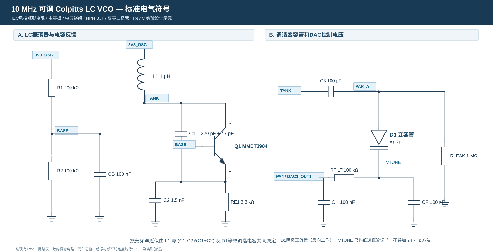
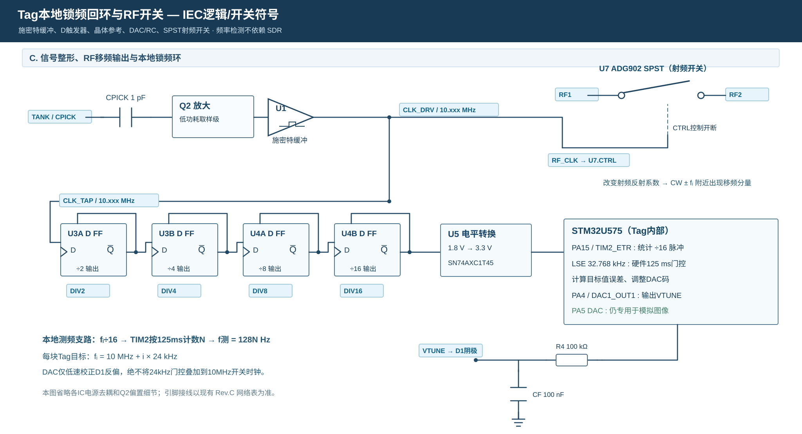

# 10 MHz 移频时钟：核心逻辑与标准电路符号（简明版）

> **状态：** Rev.C 电路原理简述，元件值沿用 [详细中文设计](Design_RevC_ZH.md) 的实验初值；尚未完成起振、相位噪声、测频固件路由及 2.4 GHz 匹配实测。  
> **制图约定：** 电阻使用IEC矩形符号，电容使用双极板、电感使用线圈、Q1使用NPN箭头符号、D1使用变容二极管符号、逻辑触发器使用D-FF符号，ADG902以SPST开关符号表示。图纸是独立SVG，不使用Mermaid或HTML绘图。

## 1. 用LC振荡器直接产生目标频率

- Q1、L1和C1/C2形成共基极Colpitts振荡器，L1与等效反馈电容及变容管D1决定10 MHz附近的谐振频率。
- STM32 PA4的DAC通过100 kΩ/100 nF低通，向D1提供**稳定直流反偏电压**，改变其结电容；因此每个节点可以直接设置为 **fᵢ = 10 MHz + i × 24 kHz**（i=0～9）。
- C3用于隔直，D1阳极经过1 MΩ回到地，D1阴极连VTUNE。**该控制电压不采用24 kHz周期门控**。

## 2. 直接控制RF开关，另一路独立测频

- 振荡正弦波经Q2模拟放大和U1施密特整形成为10.xxx MHz数字时钟；**原始时钟直接驱动ADG902的CTRL**，令反散射CW在相对载波±fᵢ附近产生频移。
- 相同的时钟另分出**测频支路**，用四级D触发器除16，再经1.8V→3.3V电平转换送至STM32 TIM2。以32.768 kHz LSE为125 ms门控参考，计数为N时 **fₘₑₐₛ ≈ 128 N Hz**，128Hz是计数量化步长，不是绝对精度。
- STM32比较目标与实测值，调整PA4 DAC码值，再改变D1电容，形成**Tag内部的低速锁频闭环（FLL）**；频率校正优先在图像帧边界执行。PA5图像DAC独立工作。

## 3. 必须留意的边界

**Tag本地FLL锁定的是RF开关驱动时钟的平均频率，不是直接检测2.4 GHz空口RF信号。** 它无法消除LC振荡器的全部近端相位噪声；24kHz节点间隔是否成立，取决于实测相位噪声、温漂、图像RF占用带宽及邻道泄漏。射频匹配和图像变容管D2应另行设计。

**设计资料：** [完整中文设计](Design_RevC_ZH.md) · [逐引脚连接表](netlist.csv) · [BOM](BOM.csv)
