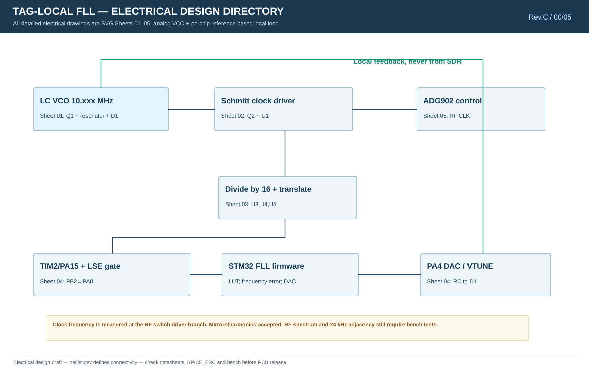
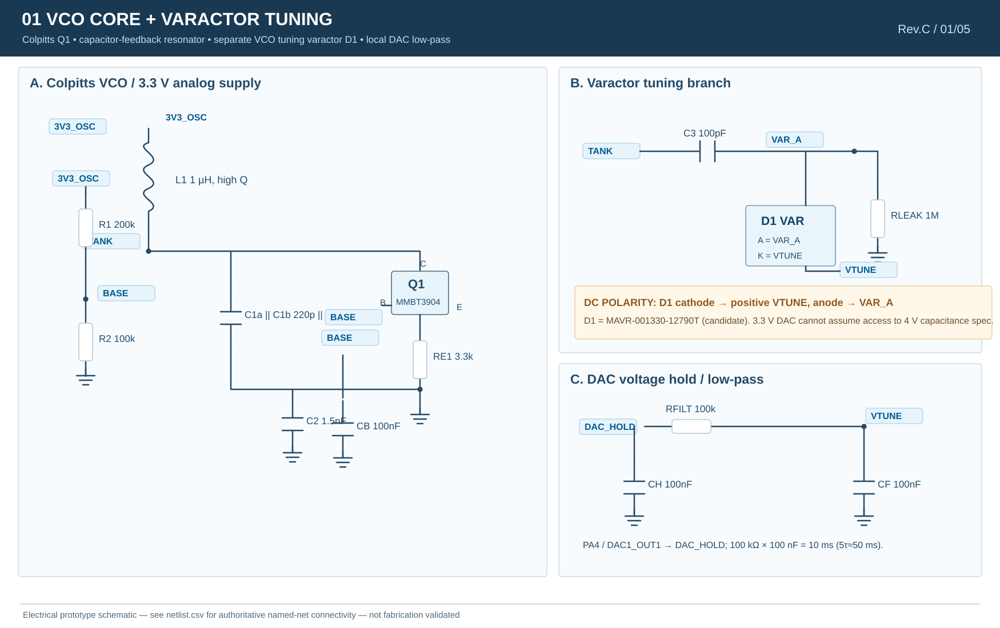
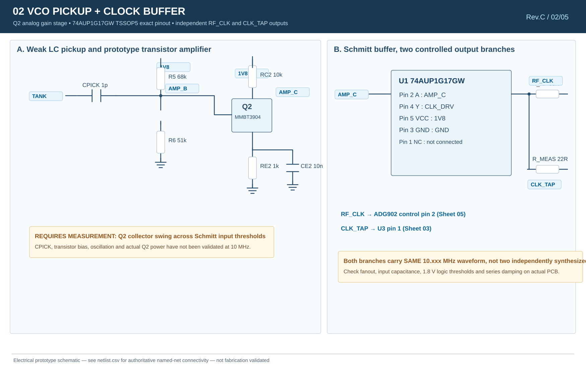
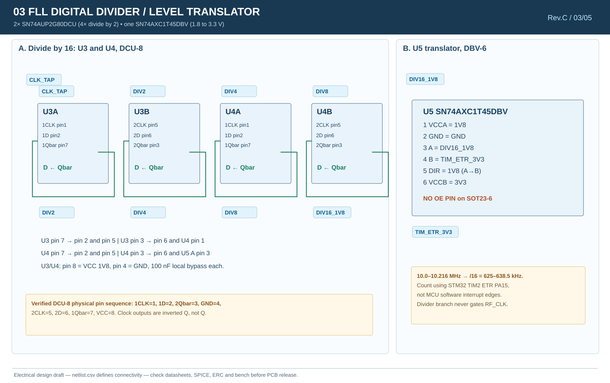
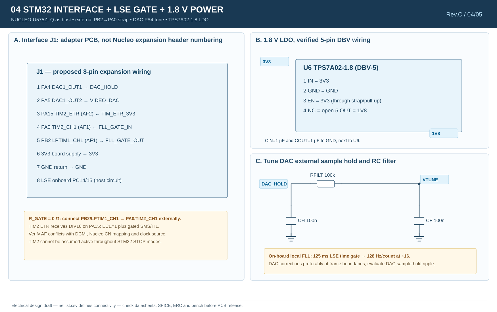
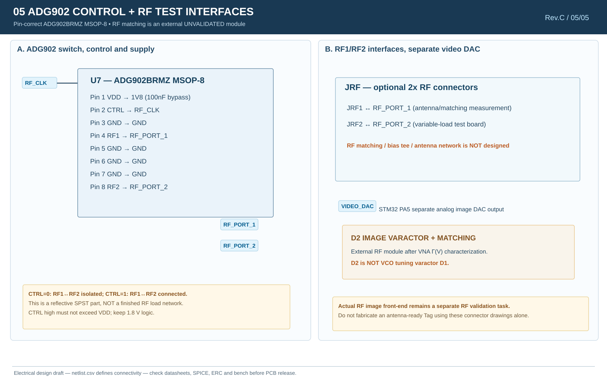

# 多节点模拟图像反散射系统：10 MHz 可调移频源与 Tag 本地闭环锁频完整设计说明（Rev.C）

> **文件状态：工程设计草案／待仿真与实测验证**  
> **版本：Rev.C-ZH 1.0；日期：2026-11-15**  
> **所属项目：** [RBzhang/Hybrid_video](https://github.com/RBzhang/Hybrid_video)  
> **适用平台：** HM0360 + STM32U575 + 图像 DAC/变容负载 + ADG902 RF Switch  
> **本文件范围：** 10.000～10.216 MHz 可调开关时钟的产生、Tag 本地测频、DAC 反馈调节、供电、元件选型、功耗与测试方法。**不包含已经定型的 2.4 GHz 图像反散射匹配网络**。  
> **图纸约定：** 所有插图均引用本仓库的独立 SVG 文件；不使用 Mermaid、HTML 或 Markdown 字符图绘制电路。电气网络以 [netlist.csv](netlist.csv) 为对照依据，SVG 仅为工程连接草图；还须转录成原生EDA原理图并通过ERC。

## 0. 执行摘要

本方案解决的不是主动生成 2.4 GHz 载波，而是**每个反散射 Tag 独立产生 10 MHz 以上、相邻节点按 24 kHz 递增的低功耗移频开关时钟**。该时钟控制 ADG902 周期性切换射频负载，令外部 CW 激励在  Tag 反射后产生相对 CW 的频移分量，模拟图像数据则继续由另一条 DAC—变容二极管链路控制反射系数。

本地闭环完整路径为：**LC VCO → Q2/施密特整形 →（一支路驱动 ADG902；另一支路四级 ÷2）→ 1.8/3.3 V 电平转换 → STM32 TIM2 本地计数 → 计算实际频率 → PA4 DAC → RC 滤波 → 调谐变容管 D1 → LC VCO**。32.768 kHz LSE 晶体提供独立测量时间基准；不使用 SDR 返回的频率读数进行反馈。

本方案有四条不可混淆的原则：

1. 每块 Tag **直接产生目标 10.xxx MHz**，不是用 10 MHz 与 24 kHz 方波做 AND 门控；测频支路的 ÷16 也**不进入 RF 发送支路**。
2. **VCO 调谐 D1 与图像调制 D2 分开**。PA4 仅调节移频时钟，PA5 负责模拟图像波形；其中图像 D2 的 2.4 GHz 匹配和偏置需要另行设计。
3. 直接在 Tag 上计数**最终驱动 RF Switch 的时钟**，可测相对 CW 的理想频移基波频率，但不等于直接测得 2.4 GHz 空口射频谱；开关延迟、相噪、镜频和谐波须另行测量。
4. **本地 FLL 只能约束低频/平均频率误差**，不能让一个高相噪 LC 振荡器自动变成晶体振荡器；24 kHz 间隔可用性必须实测。

## 1. 目录与配套 SVG 图纸



| 图纸号 | 工程图名 | 对应内容 |
|---|---|---|
| 00 | [总体电气目录](schematics/00_overview.svg) | 本地频率闭环、发送与测频分支 |
| 01 | [Colpitts VCO、调谐变容管及反馈网络](schematics/01_vco_tuning.svg) | Q1、L1、C1/C2、D1、C3、DAC偏置 |
| 02 | [模拟缓冲与时钟整形](schematics/02_clock_buffer.svg) | Q2、CPICK、U1、RF_CLK/CLK_TAP |
| 03 | [÷16 分频与电平转换](schematics/03_div16_translator.svg) | U3/U4四级二分频、U5转换 |
| 04 | [STM32、LSE 门控、DAC与供电](schematics/04_mcu_power_dac.svg) | PA4/PA5/PA15/PA0/PB2、U6 |
| 05 | [ADG902与RF测试接口](schematics/05_rf_switch_interface.svg) | U7、RF1/RF2、电气边界 |
| 附件 | [逐引脚网络表](netlist.csv) | 按网络名追踪各器件连接 |
| 附件 | [BOM](BOM.csv) | 初版采购与替换检查 |
| 附件 | [SPICE起始网表](spice/vco_generic_starter.cir) | 通用模型，**不是验证报告** |

### 1.1 成熟度说明

- **已确认／由设计文件确定：** 系统拓扑、目标频率表、测频数学公式、选定封装的主要管脚定义、相互独立的图像 DAC 与调谐 DAC。
- **已有计算、未实测：** LC 等效电容及频率、125 ms测量量化、初步偏置电流和功耗预算。
- **未验证：** 在百微安偏置下起振、C–V控制覆盖全部10个目标频点、10 MHz输入整形、电压稳定度、相位噪声、温度漂移、MCU特定定时器路由、RF匹配、图像解调和10节点FDMA性能。
- **不能据此直接制板：** 当前交付的是 SVG + CSV 连接表 + 通用SPICE起始模型，不是已进行原理图ERC、PCB DRC及实物验证的量产级CAD设计。

## 2. 设计背景、系统边界与频率分配

### 2.1 保留原模数混合图像链路

现有图像方案约为320×240、RAW8、1 FPS，原始数字图像每帧 76,800 Byte，每节点原始数据率 614.4 kbit/s。非关键帧经过数字预滤波/抽取、片内 DAC 更新、模拟重建滤波与图像变容二极管，作为连续模拟反散射发送；可靠数字关键帧走另一条数字背散射链路。

本文件只设计**模拟反散射链路的移频时钟及其Tag本地闭环**，不改动100 kSa/s量级的图像DAC采样逻辑。对每一节点，开关频率设计为

\[
f_i^*=f_0+i\Delta f,\qquad f_0=10\,000\,000\ {\rm Hz},\quad
\Delta f=24\,000\ {\rm Hz},\quad i=0,\ldots,9.
\]

| Tag编号 | 目标时钟／中心频移 MHz | 与Tag0频差 kHz | 125 ms、÷16理想计数 |
|---:|---:|---:|---:|
| 0 | 10.000 | 0 | 78,125.0 |
| 1 | 10.024 | 24 | 78,312.5 |
| 2 | 10.048 | 48 | 78,500.0 |
| 3 | 10.072 | 72 | 78,687.5 |
| 4 | 10.096 | 96 | 78,875.0 |
| 5 | 10.120 | 120 | 79,062.5 |
| 6 | 10.144 | 144 | 79,250.0 |
| 7 | 10.168 | 168 | 79,437.5 |
| 8 | 10.192 | 192 | 79,625.0 |
| 9 | 10.216 | 216 | 79,812.5 |

**注意：** 偶数/奇数目标在125 ms门控下可能产生半计数，实际计数只能是整数；不能把上述小数理解为硬件必然测出的计数结果。

### 2.2 24 kHz频点间隔不是模拟图像带宽

若单节点最终**实测**99% RF占用带宽不超过20 kHz，24 kHz中心间隔仅留下4 kHz名义保护带。若相邻节点各存在最大500 Hz相反方向的中心偏差，则名义保护带缩至约3 kHz；还必须考虑相位噪声、温漂、开关高次谐波及强弱节点效应。

100 kSa/s是图像 DAC更新速率，**并不自动意味着100 kHz RF占用带宽**；但它也**不自动保证**滤波后占用20 kHz。最终须测量 DAC重建、D2非线性、开关频移后的射频99% OBW和ACLR。若实际信号占用100 kHz量级，24 kHz信道间隔本身不成立，与移频源精度无关。

### 2.3 移频的射频模型

令开关控制方波为 `q_i(t)`（0/1），图像电压为 `V_{\rm image}(t)`，开关两个状态下的反射系数为 `\Gamma_{\rm on}(V)` 和 `\Gamma_{\rm off}(V)`。简化模型为

\[
\Gamma_i(t)=\Gamma_{\rm off}(V(t))
+[\Gamma_{\rm on}(V(t))-\Gamma_{\rm off}(V(t))]q_i(t).
\]

频移后第一边带中的图像信息与

\[
\Delta\Gamma(V)=\Gamma_{\rm on}(V)-\Gamma_{\rm off}(V)
\]

有关。即使时钟频率准确，若两种开关状态的复反射系数差随图像电压变化不足，仍不能高质量传输图像。此处**允许镜频**，不把单边带抑制作为本Rev.C功能的前提，但仍需测量谐波、杂散和邻道干扰。

## 3. 电源轨、信号命名与图纸约束

设计采用以下电压域：

| 电源／节点 | 功能 | 实施要求 |
|---|---|---|
| `3V3_OSC` | Q1振荡核心 | 独立局部退耦，避免数字边沿污染 |
| `3V3` | STM32与U5 VCCB、U6输入 | 来自现有NUCLEO板；分流记录电流 |
| `1V8` | Q2、U1、U3/U4、U5 VCCA、U7 | U6 TPS7A02-1.8提供；10 MHz逻辑不超过该轨 |
| `TANK` | LC高阻谐振节点 | 仅通过≤1pF级取样或低电容探头测量 |
| `DAC_HOLD` | PA4调谐 DAC输出 | 100nF保持/滤波参考节点 |
| `VTUNE` | D1反偏控制 | 低速直流，不进行24 kHz周期更新 |
| `CLK_DRV` | U1施密特输出 | 在此分成发送/本地测频两支路 |
| `RF_CLK` | ADG902 CTRL实际驱动支路 | 10.xxx MHz，不能做÷16或低频AND |
| `CLK_TAP` | 测频支路输入 | 与RF_CLK同源，通过独立阻尼电阻连接 |
| `DIV16_1V8` | 四级分频输出 | 625～638.5 kHz量级 |
| `TIM_ETR_3V3` | TIM2 外部计数 | U5电平转换后的3.3V逻辑 |
| `VIDEO_DAC` | PA5图像DAC | 与本地频率反馈保持独立 |

所有引脚与网络连接请以 [netlist.csv](netlist.csv) 逐行审核。SVG里交叉线、元件图形间的近距离和示意方向**不能自动代替**实际CAD网表电气连接。

## 4. LC振荡器：Colpitts核心设计



### 4.1 选用原因及风险

首版采用一颗MMBT3904 NPN晶体管、1µH高Q电感和C0G反馈电容形成**共基极Colpitts**振荡器。优点是无需80MHz FPGA时钟、分数PLL或工厂定制频点器件；控制电压可在窄频率范围连续调节。

风险是：低电流条件下晶体管跨导、环路增益和负载可能不足，造成不起振；即使起振，自由振荡LC的近端相噪和温漂也可能不足以支持只有24kHz间隔的多节点FDMA。**这不是已经实测能以数百µW稳定工作的参考电路。**

### 4.2 网络级连接表

| 元件 | 两端或三端连接 | 首版数值 |
|---|---|---|
| L1 | `3V3_OSC ↔ TANK` | 1µH，高Q，SRF明显高于10MHz |
| Q1 | 集电极`TANK`，基极`BASE`，发射极`EMIT` | MMBT3904 |
| R1 | `3V3_OSC ↔ BASE` | 200kΩ |
| R2 | `BASE ↔ GND` | 100kΩ |
| CBASE | `BASE ↔ GND` | 100nF |
| RE1 | `EMIT ↔ GND` | 3.3kΩ，预留2.2k/1.5k替换 |
| C1a、C1b | 并联连接`TANK ↔ EMIT` | 220pF + 47pF，C0G |
| C2 | `EMIT ↔ GND` | 1.5nF，C0G |
| C3 | `TANK ↔ VAR_A` | 100pF，C0G |
| D1 | 阳极`VAR_A`，阴极`VTUNE` | MAVR-001330-12790T候选 |
| RLEAK | `VAR_A ↔ GND` | 1MΩ |

Q1基极约由3.3V经200kΩ/100kΩ分压偏置；发射极电流实际依赖VBE和晶体管增益，不能简单把静态分压当作精确电流源。初次测试时，RE1应可更换，先建立足够起振裕量，再逐步压低偏置电流。

### 4.3 频率与等效电容计算

首版近似计算式：

\[
C_{\rm FB}=\frac{C_1C_2}{C_1+C_2},\quad C_1=267{\rm pF},\quad C_2=1500{\rm pF};
\]

\[
C_{\rm tune}(V)=\frac{C_3C_D(V)}{C_3+C_D(V)},
\qquad
f(V)\approx\frac1{2\pi\sqrt{L_1[C_{\rm FB}+C_{\rm tune}(V)+C_{\rm par}]}}.
\]

其中 `C_{\rm par}` 包含晶体管结电容、走线、封装、探头负载及其他寄生量；不能事先假定为稳定常数。

按L1=1µH、C3=100pF、`C_{\rm par}=8\ {\rm pF}`（**纯假设**）及MACOM候选变容管典型C–V示例，得到下表：

| VTUNE | D1典型结电容 | 等效调谐电容 | 理想计算频率 |
|---:|---:|---:|---:|
| 0.5V | 25.4pF | 20.26pF | 约9.968MHz |
| 1.0V | 20.7pF | 17.15pF | 约10.030MHz |
| 1.5V | 16.8pF | 14.38pF | 约10.085MHz |
| 2.0V | 13.2pF | 11.66pF | 约10.141MHz |
| 2.5V | 10.1pF | 9.17pF | 约10.192MHz |
| 3.0V | 7.9pF | 7.32pF | 约10.231MHz |

这个理想例子覆盖10.000～10.216MHz，但**不保证实物覆盖**。PCB应预留C1微调及C3的47/68/100/120pF可换档焊盘。D1选型前需核对具体订货后缀、阳阴极方向、供应与批次C–V公差。

### 4.4 变容二极管直流连接要求

TANK带有直流偏置，D1不应直接连接TANK；C3承担交流耦合及调谐灵敏度限制。D1阳极通过RLEAK建立到地的直流回路，阴极接正的VTUNE，从而维持反向偏置。调谐网络和图像射频Varactor使用**两颗不同的二极管**，互不共用控制电压。

验证顺序应为：固定电容起振→接入D1但先使用实验电源提供静态VTUNE→扫描0.5～3.0V频率→确认温漂及调谐单调性→最后接STM32 DAC。禁止为了追求目标频率让变容管正向导通或超过最大反向电压。

## 5. 振荡波形取样、放大、整形及输出分路



| 元件/节点 | 电气连接 | 初始数值 |
|---|---|---|
| CPICK | `TANK ↔ AMP_B` | 1pF C0G，避免谐振器被重载 |
| Q2 | B=`AMP_B`，C=`AMP_C`，E=`AMP_E` | MMBT3904 |
| R5/R6 | `1V8→AMP_B→GND` 分压 | 68kΩ/51kΩ |
| RC2 | `1V8 ↔ AMP_C` | 10kΩ |
| RE2、CE2 | `AMP_E ↔ GND` | 1kΩ、10nF并联 |
| U1 | 74AUP1G17GW，A=`AMP_C`，Y=`CLK_DRV` | 1.8V供电 |
| R_RF | `CLK_DRV ↔ RF_CLK` | 33Ω |
| R_MEAS | `CLK_DRV ↔ CLK_TAP` | 22Ω |

**必须验证：** CPICK取样后TANK振荡幅度是否明显下降；Q2静态工作点与10MHz输出幅度是否跨越U1输入门限；U1输出的高/低电平、占空比、边沿及动态电流是否满足ADG902和U3输入要求。两条时钟分路是同源分线，不是混频。

U1针对 **GW/TSSOP5** 引脚表：1=NC、2=A、3=GND、4=Y、5=VCC。变更封装或品牌时按订货后缀重新核查。

## 6. /16本地测频硬件：两颗双D触发器 + 电平转换



### 6.1 为什么必须分支测频

测量10MHz本身并不需要80MHz的高精度NCO；使用低功耗触发器将它**只在计数支路**除以16，能将TIM2外部输入频率降到625～638.5kHz。另一支路仍以原始10.xxxMHz驱动ADG902。

本地测频输入必须从**施密特之后**取，不宜直接挂到高阻LC节点。这测得的是实际RF开关**控制时钟的周期**，而不是自动获得RF输出的相位噪声或2.4GHz中心频率。

### 6.2 U3/U4选定封装的引脚与接法

两颗 `SN74AUP2G80DCU`（8脚DCU封装）的管脚定义相同：

| 管脚 | 名称 | 处理 |
|---:|---|---|
| 1 | 1CLK | 级1输入时钟 |
| 2 | 1D | 接本颗7脚 `1/Q` |
| 3 | 2/Q | 接本颗6脚 `2D`，同时作第二级输出 |
| 4 | GND | 接地 |
| 5 | 2CLK | 接本颗7脚 `1/Q` |
| 6 | 2D | 接本颗3脚 `2/Q` |
| 7 | 1/Q | 接本颗2脚，并作为第一路÷2输出 |
| 8 | VCC | 接1V8，近端100nF去耦 |

其中 `/Q` 为**反相输出**。连接本路 `D=/Q` 后，每个有效上升沿使本路输出翻转一次，因此每级二分频。连接级联关系如下：

| 段 | 输入 | 输出 |
|---|---|---|
| U3的第1路 | CLK_TAP | DIV2 = U3.7 |
| U3的第2路 | DIV2 = U3.5 | DIV4 = U3.3 |
| U4的第1路 | DIV4 = U4.1 | DIV8 = U4.7 |
| U4的第2路 | DIV8 = U4.5 | DIV16_1V8 = U4.3 |

**注意：** 不要把DCU引脚直接套到其他封装，特别是RSE封装。U3和U4均需先确认独立测试时钟下每级频率减半，再与主VCO合并。

### 6.3 U5电平转换器

`SN74AXC1T45DBV` 采用如下六脚连接：

| 脚号 | 功能 | 连接 |
|---:|---|---|
| 1 | VCCA | 1V8 |
| 2 | GND | GND |
| 3 | A | DIV16_1V8 |
| 4 | B | TIM_ETR_3V3 |
| 5 | DIR | 1V8，选择A→B |
| 6 | VCCB | 3V3 |

**该DBV-6器件没有OE脚**；旧版文字出现的“OE使能”应废止。翻译器输出给PA15的TIM2外部计数输入；不要将3.3V B端直接回灌1.8V逻辑口。U5必须就地去耦。

## 7. MCU端口、时间参考和硬件门控测频



### 7.1 推荐STM32接口配置

| STM32U575引脚 | 功能 | 网络 |
|---|---|---|
| PA4 / DAC1_OUT1 | VCO调谐控制 | DAC_HOLD |
| PA5 / DAC1_OUT2 | 图像模拟电压输出 | VIDEO_DAC |
| PA15 / TIM2_ETR (AF2) | ÷16计数输入 | TIM_ETR_3V3 |
| PA0 / TIM2_CH1 (AF1) | 门控信号输入 | FLL_GATE_IN |
| PB2 / LPTIM1_CH1 (AF1) | LSE生成门控信号 | FLL_GATE_OUT |
| PC14/PC15 | LSE晶体连接 | 优先复用NUCLEO板载电路 |
| PA13/PA14 | SWD调试 | 保留，不使用完整JTAG占用PA15 |

**接口约束：** 上表是一个需要在STM32CubeMX、RM0456、NUCLEO板卡原理图中验证的候选映射；必须检查DCMI摄像头占脚、板载连接和可用复用功能。图中J1的1～8脚表示**新设计子板的逻辑连接器**，并不是NUCLEO某个CN扩展座的实际脚号；J1第8项是LSE说明，不代表应另接一个晶振信号脚。

LPTIM1_CH1输出经板级0Ω `R_GATE` 接PA0/TIM2_CH1，形成可测的外部硬件门控。**不要假设LPTIM与TIM2之间必然有可用的内部ITR连接。**

### 7.2 时窗与测频算法

令LSE为32768Hz。LPTIM输出高电平门控4096个LSE周期：

\[
T_{\rm gate}=\frac{4096}{32768}=0.125\ {\rm s}.
\]

设在此门控窗口内，TIM2计得÷16后的上升沿整数 `N`，则

\[
\boxed{\hat f_{\rm VCO}=\frac{16N}{T_{\rm gate}}=128N\ {\rm Hz}}.
\]

因此**计数量化步长为128Hz/计数**，并非绝对测量精度。两端边界的计数相位会产生±1个计数左右的不确定性；若32.768kHz参考精度为20ppm，其在10MHz频点上对应约200Hz的系统性误差。用500ms窗口可使计数量化降至32Hz/计数，代价是计数时间和平均功耗上升。

### 7.3 推荐硬件配置及可行性检查

第一版拟采用：

- LPTIM1：LSE作为时钟源，生成约250ms周期、125ms高电平的硬件门控；具体ARR/CMP计数取值与输出极性按使用的HAL/RM确认。
- TIM2：外部时钟模式2使用ETR接收÷16信号，配置门控从模式使其仅在PA0/TI1高电平期间计数。
- 门控低电平期间读取并保存计数器结果，按测量帧边界清零，验证窗口开始/停止不丢计数。
- **不可假设TIM2在MCU Stop模式中持续统计该高速外部时钟**；首版先在Run模式稳定测频，再优化CPU/总线和测频支路占空比。

**必须先核实STM32U575具体芯片是否支持TIM2外部时钟模式2与选定门控模式的同时生效、所需定时器内核时钟以及TI1与ETR滤波时钟条件。** 如果CubeMX/RM0456不允许该组合，应改用仅在计数支路上的独立硬件门电路，或硬件捕获/DMA门限测量方案；不允许把门控信号接到ADG902的RF_CLK支路。

## 8. DAC调谐电压：工作模式、稳定时间与精度

### 8.1 具体电路

PA4输出网络为：`DAC_HOLD ↔ CH(100nF) ↔ GND`，并通过`RFILT=100kΩ`连接`VTUNE`；VTUNE还并联`CF=100nF`到地，并连接D1的阴极。

一阶低通估算：

\[
\tau=R_{\rm FILT}C_F=10\ {\rm ms},\qquad
f_c\approx15.9\ {\rm Hz}.
\]

若按5τ估算，更新调谐电压后至少需要约50ms基本沉降；实际还取决于DAC输出驱动及D1的电压依赖电容。

### 8.2 图像DAC是否还需要

- **需要一个真实可控的模拟电压源**向图像变容管D2提供灰度波形。当前方案最直接使用STM32片内`PA5/DAC1_OUT2`、定时器+DMA，更新速率25.6～100kSa/s量级。
- VCO控制`PA4/DAC1_OUT1`只需在上电标定/慢跟踪阶段更新；两者并非同一DAC通道。后续可研究GPIO静态电阻梯形网络替代PA4 DAC以节省静态功耗，但不能用24kHz PWM去门控模拟图像。
- 首版**先用连续缓冲输出DAC**确认RF频谱与闭环稳定性，再测Sample-and-Hold。低功耗S&H的外部保持电容漏电、周期刷新和电压纹波会在VCO输出形成FM杂散，不能预设“关闭DAC长期不掉电压”。

12bit DAC与3.3V参考的理想LSB为约0.806mV。若局部VCO灵敏度为100kHz/V（仅举例），1 LSB对应约80.6Hz；但DAC绝对误差、参考漂移、静态负载和VCO噪声可能远大于此数量级。

### 8.3 漏电与纹波预算

保持电容近似满足

\[
\Delta V=\frac{I_{\rm leak}\Delta t}{C_H}.
\]

例如：5nA漏电、100nF电容、100ms保持，约5mV电压变化。若`K_V=100{\rm kHz/V}`，相当于约500Hz频率漂移。高温和PCB污染会使漏电进一步增大，因此S&H是否真正省电，必须与DAC重新刷新能耗及频率纯度一起比较。

## 9. 低速本地FLL：频率标定、闭环控制与状态机

### 9.1 第一次标定：LUT优于理想电容公式

先用实验仪器验证每块Tag在允许调谐电压下的实际`f(V)`。至少扫描16～32个点，记录：

- 调谐DAC码值、实际VTUNE电压、外部计频器读数（**仅用于研发阶段交叉校验，不参与Tag闭环**）；
- Q1偏置电流、温度、起振时间、输出高/低摆幅；
- 频率曲线是否连续单调，是否在目标频点附近存在停振区。

Tag上线运行时，**只使用自己内部的TIM2频率计数数据形成闭环反馈**。LUT作为初始DAC码估计与非线性斜率修正，绝不依赖在线SDR反馈。

### 9.2 误差方程及控制律

第i个Tag目标频率`f_i^*`；每次门控计得`\hat f_i`：

\[
e_i=f_i^*-\hat f_i.
\]

标定获得局部灵敏度：

\[
K_V(V)=\frac{\mathrm df}{\mathrm dV}.
\]

可使用限幅比例控制：

\[
V_{n+1}=\operatorname{clip}
\left[V_n+\alpha\frac{e_n}{K_V(V_n)},\;V_{\min},V_{\max}\right],
\]

其中首版`\alpha=0.3`、单步变化不超过50mV、参考锁定门限±500Hz、连续3次合格视为锁定，均为**需要根据调谐曲线与测量噪声修订的候选参数**。普通反偏变容管在电压上升时电容下降、频率上升，即局部`K_V>0`，但必须实测再放开自动调节。

### 9.3 固件状态机

| 状态 | 行为 | 离开条件 |
|---|---|---|
| POWER_UP | 建立电源/LSE，确认无欠压 | 系统时钟正常 |
| OSC_START | 启动LC振荡、施密特与RF_CLK | 稳定输出/超时 |
| COARSE_LUT | 根据目标频率查表设置PA4 | DAC码写入 |
| WAIT_SETTLE | 等待≥50ms调谐RC稳定 | 超时计满 |
| MEASURE | 125ms或500ms硬件门控计数 | 有效整数计数产生 |
| CORRECT | 计算频差、限幅调整DAC | 仍超出目标误差 |
| LOCKED | 连续3窗落入目标误差 | 开始数据发送 |
| TRACK | 定期测频；**优先帧边界修正** | 误差超限返回CORRECT |
| FAULT | 停止有效图像发送/上报码 | 需要重新初始化 |

测频中断或DMA采样可降低CPU占用，但不能假定TIM2的所有操作都能在Stop模式工作。

**为什么控制环不应高速更新？** 调谐电压的改变就是给VCO施加频率调制。若在模拟图像采样期间频繁跳变，会破坏用于FDMA的窄带频谱并使视频解调产生额外误差。连续发送时可以测频，通常只在帧边界或空闲段修正，或者采用经实测验证的极小幅度慢跟踪。

### 9.4 算法伪代码（非制版固件）

```c
target_hz = 10000000.0 + tag_id * 24000.0;
dac_code = lookup_initial_code(target_hz);
set_tune_dac(dac_code);

for (;;) {
    wait_for_vco_settle();
    uint32_t N = tim2_count_div16_with_lse_gate(4096);
    if (N == 0 || !counter_valid(N)) { enter_fault(); continue; }

    double measured_hz = 128.0 * (double)N;
    double error_hz = target_hz - measured_hz;

    if (fabs(error_hz) <= 500.0) lock_streak++;
    else lock_streak = 0;

    if (lock_streak >= 3) {
        mark_locked();
        // Transmit analog image using unchanged RF_CLK.
        // Corrections to VTUNE should preferably happen at frame boundaries.
    } else if (frame_idle_or_not_yet_transmitting()) {
        double kv = lookup_local_slope_hz_per_volt(dac_code);
        if (!valid_kv(kv)) { enter_fault(); continue; }
        double delta_v = clamp(0.3 * error_hz / kv, -0.050, 0.050);
        dac_code = clamp_dac_code(dac_code + volts_to_codes(delta_v));
        set_tune_dac(dac_code);
    }
}
```

需自行填充HAL/LL寄存器配置、TIM2计数值同步锁存、计数器复位、LPTIM输出路由、超时保护和DMA事件处理。此段仅描述控制逻辑。

## 10. ADG902与图像反散射射频接口



U7选用ADG902BRMZ（MSOP8）：

| 引脚 | 功能 | 连接 |
|---:|---|---|
| 1 | VDD | 1V8 |
| 2 | CTRL | RF_CLK |
| 3、5、6、7 | GND | GND |
| 4 | RF1 | RF_PORT_1；外部匹配测试接口 |
| 8 | RF2 | RF_PORT_2；外部变容负载/匹配测试接口 |

ADG902为反射型SPST RF开关。`CTRL` 直接由10.xxxMHz时钟驱动；必须满足1.8V电源下的逻辑高低、电源绝对最大值和开关切换速度要求。现阶段通过JRF1/JRF2连接外部阻抗测试板，用VNA或SDR扫描不同图像D2偏置时的`\Gamma_{\rm on}(V)`、`\Gamma_{\rm off}(V)`、占用带宽与杂散。

**严格范围声明：** Sheet 05没有设计出已经确认能工作的2.4GHz天线匹配、RF bias-tee、图像D2的接法及完整RF网络。不要把本文件的“完整频率调节与回环方案”解释成“整个模拟图像反散射射频前端已经可直接生产”。

## 11. 电源、功耗估算与可行性预算

### 11.1 预计耗电构成

以下是**量级预算**，不是样机测量值。尤其Q1、Q2工作点、逻辑负载、测频CPU时钟没有得到实际测试数据，须保留不确定范围。

| 子模块 | 电源轨 | 工程初步估算 | 活动模式 |
|---|---|---:|---|
| Q1+LC偏置 | 3.3V | 0.3～0.6mW（需起振实测） | 正常发图期间持续 |
| Q2+U1施密特 | 1.8V | 0.2～0.5mW | 正常发图期间持续 |
| RF开关控制端充放电及扇出 | 1.8V | 约0.07～0.15mW | 正常发图期间持续 |
| PA4调谐DAC普通模式 | MCU模拟供电 | 约0.5～1.0mW（视配置） | Rev.C验证期持续 |
| U3/U4四级÷16 | 1.8V | 约0.3～0.5mW | 测频时开启，可优化 |
| U5电平转换 | 双电源 | 暂估0.02～0.12mW | 测频时开启 |
| TIM2/LPTIM/CPU增量 | MCU | 暂估0.3～2.0mW | 测频窗口 |
| LSE及支持电路 | MCU备份域 | µW量级 | 通常持续 |
| U6 1.8V LDO | 3.3V输入 | 静态很低，**但必须计入转换损耗** | 1.8V负载工作期间 |

### 11.2 LDO供电损耗绝不能遗漏

若整形和数字分频电路从1.8V轨获取`I_{\rm 1V8}`，而1.8V由3.3V线性LDO产生，则电池/3.3V源侧近似提供

\[
P_{\rm LDO,input}\simeq 3.3\,{\rm V}\,[I_{\rm 1V8}+I_Q],
\]

而不是简单的`1.8\,{\rm V}\times I_{\rm 1V8}`。前者包含在LDO中消耗的电压差。统计整机时不要同时将输入功耗与输出功耗重复相加。

### 11.3 低速间歇测频的平均功耗

例如，每1秒进行一个125ms测量窗口，测频子模块占空比约12.5%；若其活动期间增量功耗约1mW且**确实能关断或停止相关负载**，按占空比估算平均增量约125µW。但若分频器仍在持续切换，这一结论不成立；需要测量关断后的静态电流及启动时间。

当前不应宣称“本地闭环系统已达500µW或1mW”。验证后，才比较普通DAC、Sample-and-Hold DAC、静态GPIO电阻DAC，以及不同测频更新周期之间的功耗和频谱纯度。

## 12. 核心器件清单、封装及采购约束

完整清单请直接见 [BOM.csv](BOM.csv)，这里列出主器件与关键无源元件：

| 类别 | 参考 | 型号／建议值 | 数量 | 备注 |
|---|---|---|---:|---|
| 晶体管 | Q1/Q2 | MMBT3904 SOT-23 | 2 | 10MHz低电流起振与放大未确认 |
| 谐振电感 | L1 | 1µH高Q射频电感 | 1 | 关注SRF/ESR/Q/容差 |
| 反馈电容 | C1a/C1b/C2 | 220pF、47pF、1.5nF C0G | 3 | 影响中心频率和反馈 |
| 变容管 | D1 | MAVR-001330-12790T候选 | 1 | 需核对C–V及订货封装 |
| 调谐隔直 | C3 | 100pF C0G | 1 | 可换47/68/120pF |
| Q1偏置 | R1/R2/RE1 | 200k/100k/3.3k | 各1 | RE1预留调档 |
| 调谐低通 | RFILT/CH/CF | 100kΩ/100nF/100nF | 各1 | 低漏电、噪声可测 |
| 取样 | CPICK | 1pF C0G | 1 | 减少TANK负载 |
| Q2偏置 | R5/R6/RC2/RE2/CE2 | 68k/51k/10k/1k/10n | 各1 | 需要整形阈值实测 |
| 施密特 | U1 | 74AUP1G17GW | 1 | 1.8V，GW封装引脚 |
| 分频器 | U3/U4 | SN74AUP2G80DCU | 2 | 每颗两级二分频 |
| 电平转换 | U5 | SN74AXC1T45DBV | 1 | **没有OE**，DIR高 |
| 1.8V电源 | U6 | TPS7A02-1.8 DBV | 1 | 近端1µF输入输出电容 |
| RF开关 | U7 | ADG902BRMZ | 1 | RF匹配与图像负载未最终设计 |
| STM32 | 主控 | 已有NUCLEO-U575ZI-Q | 复用 | 同时复用PA4/PA5两路DAC |
| 电源去耦 | CDEC | 各IC近端100nF | 按节点 | 标注接地回流路径 |
| 时钟连接 | R_RF/R_MEAS/R_GATE | 33Ω/22Ω/0Ω | 各1 | 测频支路不影响RF发送 |
| 调试接口 | J1/JRF/TP | 排针、RF连接器、测试点 | 按图 | 新子板标号与NUCLEO排针需映射 |

**采购原则：** 不使用需要工厂定制10.xxxMHz频点的振荡器；所有节点优先采购同一版本VCO BOM，靠板上DAC+FLL设定频率。具体单价、库存、供货批次未在本设计中进行报价验证，不写“已确认低成本”。

## 13. PCB布局、接线及实物调试要求

### 13.1 PCB设计准则

1. 将Q1、L1、C1、C2、C3、D1聚集布局，使TANK走线极短、尽量远离10MHz数字时钟和DCMI/PCLK线。
2. 采用连续地参考平面，保证振荡器、缓冲器、逻辑芯片及LDO去耦有短回流路径。
3. 仅从CPICK引出TANK采样，避免普通10×示波器探头的较大电容直接拉偏谐振频率。
4. 将PA4调谐DAC的RC和参考地与PA5图像DAC高速切换电流区分，降低调谐偏置被图像纹波调频的风险。
5. U3/U4/U5靠近U1测频分支布置，所有1.8V逻辑脚不得被3.3V回灌。
6. 留出Q1、Q2电流串测跳线、VTUNE测试点、CLK_DRV与÷16测频点、RF1/RF2测量接口。
7. J1的1～8脚是子板自定义连接顺序，正式KiCad封装与NUCLEO板实际引脚必须重新一一匹配。
8. ADG902附近的2.4GHz匹配、偏置与天线线路需要单独射频设计，不可将普通低频地线接法替代射频匹配验证。

### 13.2 分阶段测试与判定

| 步骤 | 安装/开启模块 | 主要测量 | 阶段目标 |
|---|---|---|---|
| T0 | 电源U6与去耦 | 3.3V、1.8V、稳态电流 | 无极性/短路/供电错误 |
| T1 | Q1+LC，不装U1/U3 | 起振、10MHz附近频谱、偏置电流 | 可靠起振且无明显异常 |
| T2 | 加D1、可调直流源 | Vtune 0.5～3V的`f(V)`与停振区域 | 覆盖10～10.216MHz |
| T3 | 加Q2、U1 | 跨阈值摆幅、1.8V逻辑、占空比 | 能驱动RF_CLK |
| T4 | 加U3/U4/U5 | 四级输出计频、电平与抖动 | /16关系正确 |
| T5 | MCU接门控/PA4 DAC | 125ms实测计数、LSE误差、FLL锁定 | 可本地自主收敛 |
| T6 | 温漂/供电扰动 | 长时频偏、1/4/12/24kHz相噪 | 评估FDMA可用性 |
| T7 | 接ADG902与RF测试网络 | Γon/Γoff、时钟泄漏、频谱 | 证明准确频移 |
| T8 | 接PA5图像D2 | 实际RF OBW、串扰、重建质量 | 证明图像链路 |
| T9 | 两Tag及更多 | 邻道干扰、强弱节点、掉锁恢复 | 再决定是否扩至10节点 |

**准入闸门：** 振荡不起振、调谐区覆盖不全、U1输入不跨阈值、TIM2门控功能不可用、或24kHz附近相噪与干扰过高时，先停止批量制板并修改对应模块。

### 13.3 应保存的实验记录字段

建议记录：Tag ID、Vtune DAC码/实测电压、Q1/Q2静态电流、f_target、f_count、f_external_reference（仅实验交叉校验）、Tgate、计数N、LSE误差、温度、锁定迭代数、起振时间、偏差时序、不同频偏的相噪/杂散、主/镜频、99% OBW、ACLR、模拟PSNR/SSIM、图像帧丢失率、每帧能量，以及每条电源轨的动态电流。

## 14. 设计风险、未完成项与决策门槛

| 风险 | 当前事实 | 如何闭环 |
|---|---|---|
| VCO百微安起振失败 | Q1低电流跨导尚未验证 | 实物调RE1、替换高Q电感与更优晶体管 |
| 可调范围不覆盖216kHz | 理想电容计算依赖8pF寄生假设 | 扫描C–V、C3/C1可换档 |
| 时钟整形失败 | Q2偏置/CPICK/U1门限未实测 | 分级测AMP_C与U1输入/输出 |
| 计频精度或路由有误 | 模式组合与板上引脚需CubeMX/RM确认 | 硬件计数与外部频率计交叉校验 |
| DAC S&H引入FM杂散 | 外部保持漏电/刷新未测 | 先普通DAC，后逐级优化 |
| 24kHz信道不可分离 | FLL无法消除自由VCO近端相噪 | 真实邻道频谱与双Tag测试 |
| 图片信息量大于RF带宽 | DAC采样率与OBW不等价 | 同质量条件下测真实RF OBW |
| RF匹配尚未完成 | 图5只提供JRF接口 | 单独设计并实测2.4GHz D2/ADG902负载 |

如果自由LC VCO在24kHz间隔要求下无法满足相位噪声/漂移目标，即使本地FLL能把平均频率锁到±100Hz，也不能继续宣称FDMA通过。应改谐振器Q、偏置稳定性、频点间隔，或重新选择更稳定的频率源，再进行功耗比较。

## 15. 厂商资料与设计依据

1. [TI SN74AUP2G80 数据手册](https://www.ti.com/lit/ds/symlink/sn74aup2g80.pdf)：DCU物理引脚与反相输出。
2. [TI SN74AXC1T45 数据手册](https://www.ti.com/lit/ds/symlink/sn74axc1t45.pdf)：DBV-6引脚、DIR方向、双电源。
3. [Nexperia 74AUP1G17 数据手册](https://assets.nexperia.com/documents/data-sheet/74AUP1G17.pdf)：GW封装与施密特特性。
4. [TI TPS7A02 数据手册](https://www.ti.com/lit/ds/symlink/tps7a02.pdf)：1.8V低静态电流LDO。
5. [ADI ADG901/ADG902 数据手册](https://www.analog.com/media/en/technical-documentation/data-sheets/adg901_902.pdf)：ADG902 BRMZ MSOP-8、RF1/RF2/CTRL。
6. [MACOM MAVR-001330 产品页](https://www.macom.com/products/product-detail/MAVR-001330-12790T)及[系列C–V资料](https://cdn.macom.com/datasheets/MAVR-0013xx%20Series.pdf)：变容管候选及近似C–V特性。
7. [ST STM32U575系列资料](https://www.st.com/en/microcontrollers-microprocessors/stm32u575-585/documentation.html)：DAC、TIM2、LPTIM1、LSE、AF复用。
8. [ST NUCLEO-U575ZI-Q 用户手册](https://www.st.com/resource/en/user_manual/um2861-stm32u575ziq-nucleo-64-board-mb1549-stmicroelectronics.pdf)：板级晶体与引脚跳线。
9. 项目当前[英文电路总览及接口说明](README.md)、[BOM](BOM.csv)、[逐引脚连接表](netlist.csv)、[6张SVG图](schematics/00_overview.svg)。

## 附录A：设计冻结前检查清单

- [ ] Q1起振仿真使用经核验的晶体管与D1模型，覆盖供电、工差及温度。
- [ ] 用KiCad等EDA建立**真正可编辑、逐引脚相连**的原生原理图，并完成ERC。
- [ ] 检查MMBT3904及MAVR具体封装引脚方向，U3/U4 DCU和U5 DBV脚序。
- [ ] 核对NUCLEO板PA4/PA5/PA15/PA0/PB2实际排针、DCMI冲突与LSE电路。
- [ ] 确认TIM2 ECE+门控模式可用，实际最低定时器内核时钟满足ETR采样。
- [ ] 测量10个目标频点的锁定误差、频偏尾部、长时漂移、温度变化。
- [ ] 测量真实相位噪声、邻道泄漏、RF开关镜频/谐波，不能只看FLL平均误差。
- [ ] 分电源轨计量包含LDO损耗在内的平均功耗和单帧能量。
- [ ] 独立完成D2图像变容与ADG902负载联合匹配及2.4GHz测试。
- [ ] 在相同图像恢复质量下验证真实RF OBW和多节点FDMA效果。

---

**最终结论：** 本Rev.C给出了在Tag内部构造10.xxxMHz移频时钟及独立测频反馈的可复现实验电路框架，已经明确到主要元件初值、接口网络、控制方程与测试流程。它不是已经确认满足24kHz间隔和超低功耗的硬件成品。下一步的关键工作是完成本地计数硬件路由验证、LC起振与相噪实测，随后再接入图像Varactor并测量空口链路。