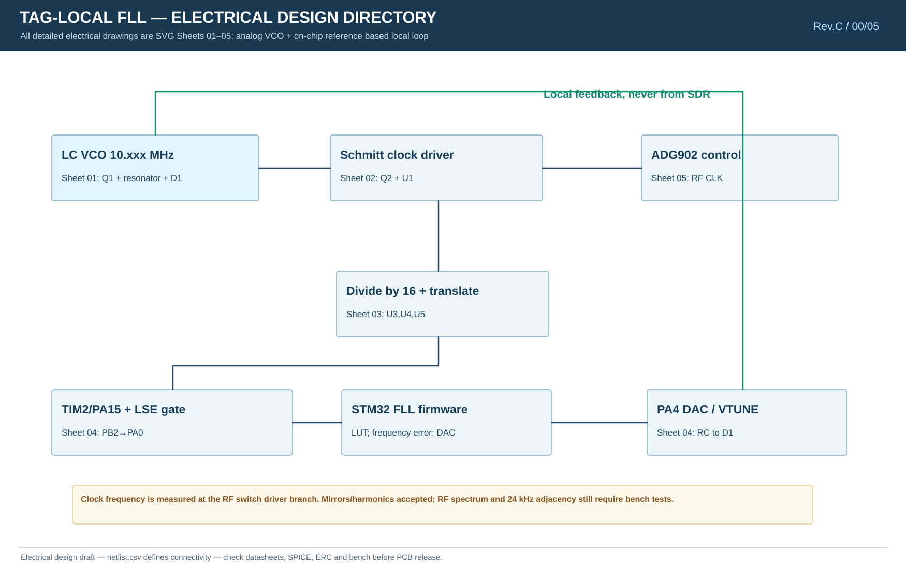

> **方案状态更新：** 对于当前STM32U575平台，优先评估新的 [PLL1 fractional-N + MCO简化方案](../pll1_mco_10mhz/Design_PLL1_MCO_ZH.md)。本目录的离散LC VCO + Tag本地FLL方案保留为备选/历史设计，只有在PLL fractional spur或相噪不满足24kHz FDMA时再考虑回退。

---

## 移频产生核心逻辑（简明版，标准电路符号）

- **[简明中文说明与两张IEC风格电路图](Core_Shift_Logic_ZH.md)**
- [Colpitts VCO与调谐变容二极管：电气原理图SVG](schematics/06_iec_colpitts_vco.svg)
- [分频测频、Tag本地FLL及RF开关：电气原理图SVG](schematics/07_iec_fll_rf_switch.svg)

---

# Rev.C 本地锁频移频源：中文完整设计文档

**中文工程说明入口：** [Design_RevC_ZH.md](Design_RevC_ZH.md)

这份中文文档整合了10.000–10.216 MHz Colpitts VCO、可调变容二极管、10 MHz数字整形、四级二分频、STM32U575本地门控测频、DAC低速锁频、供电和功耗预算、完整BOM、逐引脚连接表及实验验收计划，并引用下方6张SVG原理图。设计尚需SPICE、ERC和实测验证；2.4 GHz图像射频匹配网络不属于已完成范围。

---

# 10 MHz Tag-local FLL: Rev.C SVG electrical drawings

**Status: draft electrical design for bench validation.** This is NOT an ERC-checked KiCad schematic or a PCB-ready RF design.

All drawings below are SVG. There are no Mermaid, HTML, or ASCII diagrams as the artwork.

## Individual electrical sheets

- [01 — Q1 Colpitts VCO, D1 varactor, and tuning low-pass](schematics/01_vco_tuning.svg)
- [02 — LC signal pickup, Q2 buffer, 74AUP1G17GW](schematics/02_clock_buffer.svg)
- [03 — Four /2 stages using U3/U4 SN74AUP2G80DCU and U5 translator](schematics/03_div16_translator.svg)
- [04 — STM32U575 Nucleo signals, LSE gate wiring, and 1.8 V LDO](schematics/04_mcu_power_dac.svg)
- [05 — ADG902 MSOP-8 and separated RF test connectors](schematics/05_rf_switch_interface.svg)

## Connection files

- [Pin-by-pin connection table](netlist.csv) — authoritative named-net source for CAD reconstruction.
- [Component BOM](BOM.csv) — suggested parts, quantities, pads, constraints.
- [Generic oscillator SPICE starter](spice/vco_generic_starter.cir) — no claim of verified startup, spectral purity, or power.

## Firmware + local loop

Each Tag generates an adjustable RF-switch clock near 10 MHz, with target f_i = 10 MHz + i×24 kHz. Clocking of the ADG902 is not gated by a 24 kHz signal. A tap after the 1.8 V Schmitt buffer enters four flip-flop divide-by-two stages. The ~625 kHz final output is translated to 3.3 V and counted by TIM2 ETR on PA15. An independent 32768 Hz LSE-driven LPTIM1_CH1 on PB2 generates a 4096-tick window (125 ms), routed through R_GATE=0 ohm to PA0 TIM2_CH1. Set TIM2 ECE=1 and gated mode with trigger TI1, pending verification in STM32CubeMX/RM0456. Frequency estimate = 16 N / 0.125 = 128 N Hz, which is a count quantum, not crystal-clock accuracy. STM32 PA4 DAC1_OUT1 sets VCO tuning voltage via an RC filter; PA5 DAC1_OUT2 is reserved for image modulation. No SDR is used for feedback.

Suggested controller: INIT → VCO_START → LUT_COARSE → RC_SETTLE (at least 50 ms) → COUNT125 → ERROR → BOUNDED_DAC_UPDATE → RECOUNT → LOCKED → FRAME_BOUNDARY_TRACK. The analog VCO is not a crystal source and its 1 kHz / 24 kHz offset phase noise must be measured. Avoid substantial voltage corrections mid-image-frame.

## Known implementation risks

- Oscillator bias, feedback, 1 uH tank and low-current transistor startup are not yet simulated with calibrated parts. Q2 amplifier may not cross the Schmitt thresholds at 10 MHz.
- D1 junction polarity is cathode = VTUNE, anode = VAR_A. D2 image varactor is separate and is NOT finalized here.
- The STM32 signal names are logical connector wires: J1 numbering is newly assigned for the add-on board, not the Nucleo expansion headers. Check actual Nucleo CN connectors and DCMI overlaps.
- U5 SN74AXC1T45DBV has **no OE pin**. Pin 5 DIR high provides A to B level translation.
- The RF matching network, varactor image load, antenna impedance and 2.4 GHz performance are deliberately outside this frequency-generation closed-loop module. JRF1/JRF2 are laboratory interfaces, not an antenna-ready design.
- Measure first: steady 10.000–10.216 MHz coverage, 10 MHz waveform thresholds, 125 ms counter resolution, lock convergence, drift, 24 kHz nearby phase noise / adjacent-channel spur, and power by rail.
- Power values are design targets only. The 1.8 V LDO input power from 3.3 V cannot be equated to power delivered at 1.8 V.

## Part manufacturer sources

- Texas Instruments [SN74AUP2G80](https://www.ti.com/lit/ds/symlink/sn74aup2g80.pdf) DCU pins: 1 1CLK, 2 1D, 3 2Qbar, 4 GND, 5 2CLK, 6 2D, 7 1Qbar, 8 VCC.
- TI [SN74AXC1T45](https://www.ti.com/lit/ds/symlink/sn74axc1t45.pdf) DBV: 1 VCCA, 2 GND, 3 A, 4 B, 5 DIR, 6 VCCB; no OE.
- Nexperia [74AUP1G17](https://assets.nexperia.com/documents/data-sheet/74AUP1G17.pdf) GW TSSOP5: 1 NC, 2 A, 3 GND, 4 Y, 5 VCC.
- TI [TPS7A02](https://www.ti.com/lit/ds/symlink/tps7a02.pdf) DBV: 1 IN, 2 GND, 3 EN, 4 NC, 5 OUT.
- Analog Devices [ADG902](https://www.analog.com/media/en/technical-documentation/data-sheets/adg901_902.pdf) MSOP8: 1 VDD, 2 CTRL, 3/5/6/7 GND, 4 RF1, 8 RF2.
- MACOM [MAVR-001330-12790T](https://www.macom.com/products/product-detail/MAVR-001330-12790T) D1 tuning diode candidate.
- ST [STM32U575](https://www.st.com/resource/en/datasheet/stm32u575vg.pdf) PA4 DAC1_CH1, PA5 DAC1_CH2, PA15 TIM2_ETR AF2, PB2 LPTIM1_CH1 AF1, PA0 TIM2_CH1 AF1.

## Acceptance before fabrication

1. Verify device footprint pin-1 orientation, power decoupling and all net labels against netlist.csv.
2. Run SPICE with measured or manufacturer transistor and varactor models; verify startup over supply/temperature.
3. Rebuild and ERC check a proper native EDA schematic, then send for RF layout review.
4. Bench verify tuning range, 24 kHz adjacent-channel phase noise, frequencies in both switched RF loads, voltage drift, RF OBW and power.
