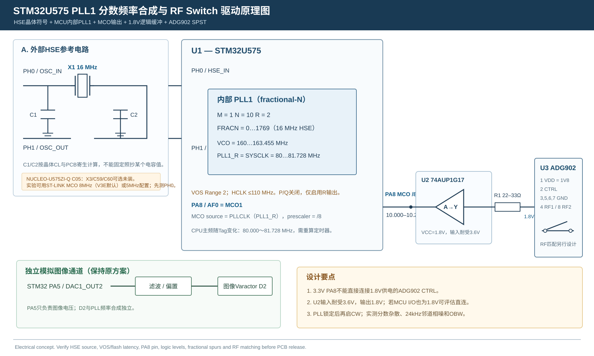

# STM32U575 PLL1 分数频率合成与 MCO 移频时钟：详细设计说明

> **版本：** PLL1-MCO Rev.B（工程设计与验证版）  
> **日期：** 2026-11-16  
> **平台：** STM32U575ZIT6Q / NUCLEO-U575ZI-Q  
> **用途：** 多节点模拟图像反散射的移频时钟产生  
> **目标：** 每个 Tag 输出 10.000 MHz～10.216 MHz 时钟，相邻节点间隔 24 kHz  
> **核心架构：** 16 MHz HSE → STM32U575 PLL1 fractional-N → PLL1_R → MCO /8 → 1.8 V逻辑缓冲 → ADG902 CTRL

> **重要状态声明：** 本文是基于 ST 官方数据手册、参考手册和 NUCLEO 用户手册整理的工程设计方案。频率公式和 FRACN 表为理论计算值；尚未在实物板上验证 MCO 频谱、分数杂散、24 kHz 邻道性能和完整图像链路。不得把计算表视为实测结果或量产保证。

## 0. 方案结论

原来的外部 LC VCO + 变容调谐 + ÷16 测频 + STM32 DAC 反馈方案，对当前 STM32U575 平台而言过于复杂。STM32U575 自带支持 13 bit FRACN 的 PLL1，可以直接合成 10 MHz 附近的可编程时钟，再从 MCO 引脚输出。

本方案采用：

- HSE：16 MHz 外部晶体；
- PLL1 输入分频 M=2，PLL1 倍频 N=20，PLL1_R 分频 R=2；
- FRACN：按 Tag ID 配置；
- PLL1_R：80.000 MHz～81.728 MHz；
- MCO：PLL1_R /8，得到 10.000 MHz～10.216 MHz；
- PA8 / AF0：MCO 输出；
- 74AUP1G17：将 3.3 V MCO 转为 1.8 V逻辑；
- ADG902：由 1.8 V时钟驱动射频反射开关。

**取消的外部硬件：** LC VCO、调谐变容管 D1、VCO 缓冲放大器、÷16 分频器、额外电平转换器、测频定时器支路和 DAC 频率反馈。  
**保留的原系统硬件：** STM32U575、模拟图像 DAC（PA5）、图像调制变容二极管 D2、ADG902、CW 激励源和图像接收链路。

这里取消的是 Tag 外部频率测量与反馈环（FLL），不是 PLL 内部锁相环。PLL 仍然依赖 HSE 参考时钟自动锁定。

## 1. 系统功能边界

本设计只负责生成 RF Switch 的低频控制时钟。它不直接产生 2.4 GHz RF 载波，也不替代图像模拟调制链路。

- PA8 输出 10.xxx MHz 方波，控制 ADG902 的 CTRL。
- ADG902 周期性切换射频反射状态，使外部 CW 激励在反射频谱中出现相对载波的频移分量。
- PA5/DAC1_OUT2 继续输出图像模拟电压，驱动独立的图像变容二极管 D2。
- D2 的 2.4 GHz 偏置、匹配网络、天线和反射系数映射仍需单独设计。

方波控制会带来基波及高次谐波对应的反射频谱分量。允许存在镜频不等于可以忽略高次谐波和邻道杂散；仍需通过 RF 实测判断是否影响 24 kHz 间隔的 FDMA。

## 2. PLL1 分数频率合成原理

### 2.1 PLL 频率关系

STM32U575 的 PLL1 使用参考时钟、输入分频器 M、整数倍频 N、13 bit 分数项 FRACN 和输出分频器 R。计算关系为：

$$
f_{\mathrm{PLL1,in}}=\frac{f_{\mathrm{HSE}}}{M}
$$

$$
f_{\mathrm{VCO}}=f_{\mathrm{PLL1,in}}
\left(N+\frac{\mathrm{FRACN}}{8192}\right)
$$

$$
f_{\mathrm{PLL1\_R}}=\frac{f_{\mathrm{VCO}}}{R}
$$

MCO 选择 PLL1 主 PLL 时钟（PLL1_R / PLLCLK）并进行 8 分频：

$$
f_{\mathrm{MCO}}=\frac{f_{\mathrm{HSE}}}
{M\cdot R\cdot 8}
\left(N+\frac{\mathrm{FRACN}}{8192}\right)
$$

FRACN 的合法范围为 0～8191。FRACN 每增加 1，MCO 频率变化：

$$
\Delta f_{\mathrm{MCO}}=
\frac{f_{\mathrm{HSE}}}{M\cdot R\cdot 8\cdot8192}
$$

### 2.2 推荐的最终配置

选择 16 MHz HSE，并令 PLL1 输入经过 /2，得到 8 MHz PLL 输入：

| 参数 | 配置 | 说明 |
|---|---:|---|
| HSE | 16 MHz | 外部晶体参考 |
| PLL1 source | HSE | 不使用 HSI/MSI 作为最终精度参考 |
| PLL1M | 2 | 16 MHz /2 = 8 MHz |
| PLL1N | 20 | 整数倍频 |
| PLL1R | 2 | VCO 输出 /2 |
| PLL1FRACN | 0～3539 | Tag ID 对应 |
| PLL1 输入频率范围 | 8～16 MHz 档 | PLL 输入为 8 MHz，位于该档下边界 |
| PLL1_R 输出 | Enable | 只需要 R 输出 |
| PLL1_P / PLL1_Q | Disable | 本方案不使用 |
| MCO source | PLLCLK（PLL1_R） | RCC MCO 选择主 PLL 输出 |
| MCO prescaler | /8 | 输出 10.xxx MHz |
| MCO pin | PA8 / AF0 | STM32U575 引脚复用表确认 |

代入参数：

$$
f_{\mathrm{PLL1,in}}=16/2=8\ \mathrm{MHz}
$$

$$
f_{\mathrm{VCO}}=8\ \mathrm{MHz}
\left(20+\frac{\mathrm{FRACN}}{8192}\right)
$$

$$
f_{\mathrm{PLL1\_R}}=80\ \mathrm{MHz}
+488.28125\cdot\mathrm{FRACN}\ \mathrm{Hz}
$$

$$
\boxed{f_{\mathrm{MCO}}=
10\ \mathrm{MHz}
+61.03515625\cdot\mathrm{FRACN}\ \mathrm{Hz}}
$$

因此，MCO 的理论设置步进约为 61.035 Hz。

本配置的 PLL1 VCO 范围为 160.000～163.456 MHz，PLL1_R 范围为 80.000～81.728 MHz。VCO 处于 STM32U575 数据手册允许范围内；PLL1_R 输出和 HCLK 均低于 Voltage Scaling Range 2 的 110 MHz 上限。建议使用 VOS Range 2，并按实际 VDD/HCLK 配置 Flash latency。

### 2.3 为什么选 M=2、N=20，而不是 M=1、N=10

两种配置在 HSE=16 MHz、R=2、MCO /8 时都能生成相同的 10 MHz 中心频率和 160 MHz VCO：

- M=1、N=10：PLL 输入 16 MHz，MCO 频率步进约 122.070 Hz；
- M=2、N=20：PLL 输入 8 MHz，MCO 频率步进约 61.035 Hz。

本方案选择 M=2、N=20，原因是输入参考频率降到 8 MHz，且频率设置分辨率提高一倍。8 MHz PLL 输入符合数据手册 4～16 MHz 的输入范围；RGE 选择 8～16 MHz 档。

更高的 FRACN 分辨率只改善频率量化误差，不会自动改善 HSE 精度、PLL 相位噪声或分数杂散。

## 3. 10 个 Tag 的频率配置

目标频率：

$$
f_i^*=10\ \mathrm{MHz}+i\cdot24\ \mathrm{kHz},
\quad i=0,\ldots,9
$$

FRACN 取整公式：

$$
\mathrm{FRACN}_i=
\operatorname{round}
\left(
\frac{f_i^*-10\ \mathrm{MHz}}
{61.03515625\ \mathrm{Hz}}
\right)
$$

| Tag ID | FRACN | 理论 MCO 频率 (MHz) | 量化误差 (Hz) |
|---:|---:|---:|---:|
| 0 | 0 | 10.000000000 | 0.0 |
| 1 | 393 | 10.023986816 | -13.2 |
| 2 | 786 | 10.047973633 | -26.4 |
| 3 | 1180 | 10.072021484 | +21.5 |
| 4 | 1573 | 10.096008301 | +8.3 |
| 5 | 1966 | 10.119995117 | -4.9 |
| 6 | 2359 | 10.143981934 | -18.1 |
| 7 | 2753 | 10.168029785 | +29.8 |
| 8 | 3146 | 10.192016602 | +16.6 |
| 9 | 3539 | 10.216003418 | +3.4 |

最大量化误差约 30.5 Hz，远小于 24 kHz 的信道间隔。完整表格也在 [tag_frequency_table.csv](tag_frequency_table.csv)。

**表格前提：** HSE 标称为精确 16.000000 MHz。实际 MCO 频率会按 HSE 的实际频差同比例变化。FRACN 量化误差不是晶体的绝对频率误差。

## 4. 时钟树与 CPU 频率影响

推荐将 PLL1_R 同时用作 SYSCLK 和 MCO 源，AHB prescaler = /1，APB prescaler 按需要设置。这样可避免额外启用第二个 PLL：

| 时钟节点 | 频率范围 |
|---|---:|
| HSE | 16 MHz |
| PLL1 输入 | 8 MHz |
| PLL1 VCO | 160.000～163.456 MHz |
| PLL1_R | 80.000～81.728 MHz |
| SYSCLK（推荐共享） | 80.000～81.728 MHz |
| HCLK（AHB /1） | 80.000～81.728 MHz |
| MCO（PLL1_R /8） | 10.000～10.216 MHz |

这意味着 CPU 主频会随 Tag 频点变化，而不是固定 80 MHz。80～81.728 MHz 低于 Range 2 的 110 MHz HCLK 上限。

对于当前 320×240、1 FPS 图像链路，80 MHz 可以作为首轮验证配置，但不能未经 profiling 就断言一定够用。必须测量 DCMI+DMA、65-tap FIR、关键帧检测和 DAC DMA 的最坏执行时间。

如果 CPU 需要保持更高且固定的主频，可以考虑：
1. 将 SYSCLK 选为独立时钟源，但该时钟的性能可能不足；
2. 额外启用 PLL2 提供 CPU 时钟，但会增加功耗和时钟树复杂度；
3. 重新分配图像算法/采样时钟。

本简化方案优先采用共享 PLL1_R，接受 CPU 约 80 MHz 的运行频率，并以实测工作负载决定是否保留。

### 4.1 图像 DAC 采样率的重算

如果 APB prescaler = /1，且相关定时器时钟来自 PCLK，则可近似使用：

$$
f_s=\frac{f_{\mathrm{TIM}}}
{(PSC+1)(ARR+1)}
$$

例如目标 100 kSa/s：
- Tag0：HCLK=80 MHz，PSC=0，ARR=799，得到 100 kSa/s；
- Tag9：HCLK≈81.728 MHz，PSC=0，ARR≈816，得到约 100.0337 kSa/s。

若必须严格保持相同的长期平均采样率，可以评估 DMA 交替更新 ARR 的分数周期方案；但这会引入一个定时器 tick 量级的采样间隔变化，必须评估对图像重建的影响。也可以重新选择独立定时器时钟源，但要核对 STM32U575 对应 TIMx 的实际 kernel clock mux。

所有基于 HCLK/PCLK 的 UART、SysTick、定时器、DAC 触发频率都应按实际 FRACN 重新计算，不能继续使用固定 80/160 MHz 的旧配置。

## 5. NUCLEO-U575ZI-Q 的 HSE 参考源

### 5.1 先检查 X3 是否实际安装

NUCLEO-U575ZI-Q 的板载 16 MHz HSE 晶体 X3 及其负载电容位置在部分板卡版本/配置中属于可选未装。不能只看用户手册就假设手上的板子已经安装。

若使用板载 16 MHz 晶体，UM2861 Rev.10 给出的配置为：
- SB47、SB49：OFF；
- SB48：OFF；
- SB4、SB5：ON；
- X3、C59、C60 按实际晶体 CL 与 PCB 寄生选型和安装。

用户手册给出的晶体示例参数为 16 MHz、8 pF、20 ppm。C59/C60 不应固定照抄某个数值，应按晶体负载电容 CL、引脚/PCB寄生电容和 AN2867 计算。

### 5.2 外部有源时钟实验方式

若没有安装 X3，可以先使用外部 16 MHz CMOS 有源振荡器：
- 输出接 PH0/OSC_IN；
- STM32 配置 HSE bypass；
- 按 UM2861 的 external oscillator to PH0 配置焊桥；
- 先确认输出幅度、占空比、频率和 PH0 输入电气限制。

该方式适合 bring-up，但最终多 Tag 应采用频率稳定度明确的独立参考源。

### 5.3 ST-LINK MCO 仅用于实验验证

UM2861 描述 ST-LINK-V3E 的 MCO 默认 8 MHz，且可能随固件升级变化；板上默认连接状态也需要按板卡版本和焊桥确认。它可以作为单板 bring-up 的参考输入，但不应在没有实测和稳定度保证的情况下作为最终多 Tag 的高精度参考。

如果 PH0 实测为 8 MHz，可使用 HSE bypass、M=1、N=20、R=2、MCO /8，仍得到同一组 FRACN 表。此配置只用于实验，最终设计仍建议 16 MHz 晶体。

## 6. MCO 输出与 ADG902 电平接口

### 6.1 PA8 输出配置

STM32U575 数据手册确认 PA8 可复用为 AF0 MCO。建议：
- GPIO mode：Alternate Function；
- AF：AF0；
- Output type：Push-pull；
- Speed：Very High；
- Pull：No Pull；
- MCO source：PLLCLK（PLL1_R）；
- MCO prescaler：/8。

PA8 输出 3.3 V 域的 10.xxx MHz 方波。走线尽量短，避免大电容探头直接加载 MCO。

### 6.2 为什么需要 1.8 V 缓冲

ADG902 的 VDD 工作范围为 1.65～2.75 V，CTRL 输入不能超过器件电源电压。NUCLEO 默认 MCU I/O 为 3.3 V，因此不能将 PA8 直接连接到 1.8 V 供电的 ADG902 CTRL。

推荐使用 Nexperia 74AUP1G17GW：
| 引脚 | 连接 |
|---:|---|
| 1 | NC，不连接 |
| 2 | A，接 PA8/MCO |
| 3 | GND |
| 4 | Y，接 ADG902 CTRL |
| 5 | VCC，接 1.8 V |

74AUP1G17 的供电范围为 0.8～3.6 V，输入耐受至 3.6 V，因此可在 VCC=1.8 V 时接收 3.3 V MCO 输入并输出 1.8 V 逻辑。U1 附近放置 100 nF 去耦；输出端预留 22～33 Ω 串联阻尼电阻，依据实测边沿调整。

ADG902 使用 1.8 V 供电，并在 VDD 附近放置 100 nF 去耦。若未来整个 MCU I/O 域也运行在 1.8 V，且所有摄像头/调试/通信外设均兼容，才可评估省略缓冲器。

### 6.3 射频开关的频移作用

10.xxx MHz 只是一条数字控制时钟，不是 2.4 GHz RF 信号。ADG902 在这条时钟驱动下切换射频反射状态。真实反散射频谱取决于：
- CW 激励频率和功率；
- ADG902 两状态的反射系数；
- D2 图像变容二极管的阻抗变化；
- RF 匹配网络、天线和传播信道；
- 方波控制的基波、奇次谐波及分数杂散。

本设计允许存在镜频，但不等于忽略高次谐波或相邻 24 kHz 信道的杂散。图像 D2 的偏置和 2.4 GHz 匹配不属于本文件已定型内容。

## 7. 固件配置与启动流程

### 7.1 Tag ID 到 FRACN

每块 Tag 在 Flash 参数、编译期宏或板上 ID 电阻中保存自己的 Tag ID。启动时查表获得 FRACN。无需在线测频、DAC 调谐或 SDR 回传。

### 7.2 初始化顺序

1. 配置 HSE 晶体模式或 HSE bypass，启动 HSE 并等待 HSERDY；
2. 配置 PWR Voltage Scaling Range 2，等待 VOS ready；
3. 根据实际 HCLK 和 VDD 设置 Flash latency；
4. 如果 PLL1 当前是 SYSCLK，先切到安全时钟源，再关闭 PLL1；
5. PLL1 source = HSE，M=2，N=20，R=2；
6. PLL1 输入范围选择 8～16 MHz（本方案输入 8 MHz）；
7. 配置 PLL1MBOOST/EPOD 等辅助项，按 STM32CubeU5/CubeMX 生成配置核对；
8. 只使能 PLL1_R，关闭不需要的 P/Q 输出；
9. Tag0 使用 FRACN=0 整数模式；Tag1～9 写入表中 FRACN 并使能 fractional mode；
10. 使能 PLL1，等待 PLL1RDY；
11. 配置 AHB/APB prescaler；推荐先 /1；
12. SYSCLK 切换至 PLL1_R，HCLK 变为 80～81.728 MHz；
13. MCO source = PLLCLK（PLL1_R），MCO prescaler=/8；
14. PA8 配置 AF0 MCO；
15. 初始化 1.8 V 逻辑电源、74AUP1G17 和 ADG902；
16. 等待时钟稳定后再开启 CW 激励和有效模拟图像传输。

Fractional mode 锁定时间在数据手册指定条件下最大约 65 µs；工程上建议留出更长的保守等待时间，并通过示波器/频率计验证稳定后再打开 RF 激励。

### 7.3 LL 初始化代码骨架

以下代码展示最终 16 MHz HSE 方案的主要配置关系。它不是完整可直接编译的工程，仍需补充 HSE 启动、VOS、Flash latency、超时保护、GPIO时钟和外设重配。请以项目安装的 STM32CubeU5 版本中 stm32u5xx_ll_rcc.h 的真实 API 名称为准。

~~~c
#include "main.h"
#include "system_stm32u5xx.h"
#include "stm32u5xx_ll_rcc.h"
#include "stm32u5xx_ll_gpio.h"

static const uint16_t tag_fracn[10] = {
    0, 393, 786, 1180, 1573,
    1966, 2359, 2753, 3146, 3539
};

static uint32_t pll1_r_hz(uint16_t fracn)
{
    /* HSE=16 MHz, M=2, N=20, R=2 */
    uint64_t numerator =
        16000000ULL * (20ULL * 8192ULL + fracn);

    return (uint32_t)(numerator / (2ULL * 2ULL * 8192ULL));
}

void ShiftClock_Init(uint8_t tag_id)
{
    uint16_t fracn = (tag_id < 10U) ? tag_fracn[tag_id] : 0U;

    /* 0. HSE must already be configured and HSERDY=1.
       1. Configure VOS Range 2 and Flash latency before raising HCLK.
       2. If PLL1 is current SYSCLK, switch to HSE/MSI first. */

    LL_RCC_PLL1_Disable();
    while (LL_RCC_PLL1_IsReady()) {
        /* Add timeout/watchdog in production. */
    }

    LL_RCC_PLL1_ConfigDomain_SYS(
        LL_RCC_PLL1SOURCE_HSE,
        2U,     /* M */
        20U,    /* N */
        2U      /* R */
    );

    LL_RCC_PLL1_SetVCOInputRange(LL_RCC_PLLINPUTRANGE_8_16);
    LL_RCC_SetPll1EPodPrescaler(LL_RCC_PLL1MBOOST_DIV_1);

    LL_RCC_PLL1_DisableDomain_SAI();   /* P output unused */
    LL_RCC_PLL1_DisableDomain_48M();   /* Q output unused */
    LL_RCC_PLL1_EnableDomain_SYS();    /* R output enabled */

    if (fracn == 0U) {
        LL_RCC_PLL1FRACN_Disable();
    } else {
        LL_RCC_PLL1_SetFRACN(fracn);
        LL_RCC_PLL1FRACN_Enable();
    }

    LL_RCC_PLL1_Enable();
    while (!LL_RCC_PLL1_IsReady()) {
        /* Add timeout/watchdog in production. */
    }

    LL_RCC_SetAHBPrescaler(LL_RCC_SYSCLK_DIV_1);
    LL_RCC_SetAPB1Prescaler(LL_RCC_APB1_DIV_1);
    LL_RCC_SetAPB2Prescaler(LL_RCC_APB2_DIV_1);
    LL_RCC_SetAPB3Prescaler(LL_RCC_APB3_DIV_1);

    LL_RCC_SetSysClkSource(LL_RCC_SYS_CLKSOURCE_PLL1);
    while (LL_RCC_GetSysClkSource() !=
           LL_RCC_SYS_CLKSOURCE_STATUS_PLL1) {
    }

    SystemCoreClock = pll1_r_hz(fracn);

    LL_RCC_ConfigMCO(LL_RCC_MCO1SOURCE_PLLCLK,
                     LL_RCC_MCO1_DIV_8);

    /* GPIOA clock must be enabled by application. */
    LL_GPIO_SetPinMode(GPIOA, LL_GPIO_PIN_8,
                       LL_GPIO_MODE_ALTERNATE);
    LL_GPIO_SetAFPin_8_15(GPIOA, LL_GPIO_PIN_8,
                          LL_GPIO_AF_0);
    LL_GPIO_SetPinOutputType(GPIOA, LL_GPIO_PIN_8,
                             LL_GPIO_OUTPUT_PUSHPULL);
    LL_GPIO_SetPinSpeed(GPIOA, LL_GPIO_PIN_8,
                        LL_GPIO_SPEED_FREQ_VERY_HIGH);
    LL_GPIO_SetPinPull(GPIOA, LL_GPIO_PIN_8,
                       LL_GPIO_PULL_NO);

    /* Recompute timer/DAC trigger and UART clocks from actual FRACN. */
}
~~~

**注意：** 运行时修改 FRACN 需要按参考手册规定的 FRACEN 清零、等待参考周期、写入 FRACN、重新使能的顺序操作。当前设计只在启动时配置一次，不建议在图像发送期间动态改频。

## 8. 图像采样与系统时钟兼容性

PLL1_R 作为 SYSCLK 后，HCLK 会随 Tag ID 变化。必须重新配置：
- DCMI 像素时钟/采集时序；
- 65-tap FIR 的实时执行预算；
- DAC 定时器更新频率；
- UART 波特率和 SysTick；
- 所有依赖 HCLK/PCLK 的定时器。

例如 100 kSa/s 图像 DAC，Tag0 使用 80 MHz timer clock 时 PSC=0、ARR=799 可得到 100 kSa/s。Tag9 HCLK 约 81.728 MHz，使用 ARR=816 可得到约 100.0337 kSa/s。若要求严格平均采样率，需采用分数周期 ARR 序列或独立 timer clock，并测量采样时刻抖动对图像重建的影响。

建议在固件中根据 FRACN 计算真实 HCLK，更新 SystemCoreClock 和定时器参数；不能假定 HAL 的 SystemCoreClockUpdate 在当前版本中一定自动计入 PLL FRACN，须检查安装的 STM32CubeU5 源码。

## 9. HSE 精度、频率误差与 24 kHz FDMA

### 9.1 两种不同误差

- **FRACN 量化误差：** 本方案表格最大约 30.5 Hz；
- **HSE 绝对频率误差：** 若总频率稳定度为 ±20 ppm，在 10 MHz 处约 ±200 Hz，在 10.216 MHz 处约 ±204 Hz。

因此实际 Tag 之间的频率误差主要由 HSE 决定，不是 FRACN 的 61 Hz 量化步进。

若相邻两个 Tag 的晶体误差方向相反，中心间距最坏可减少约 0.4 kHz，名义 24 kHz 间隔降到约 23.6 kHz。若单节点真实 RF 占用带宽为 20 kHz，剩余名义保护带约 3.6 kHz。

### 9.2 分数 PLL 杂散和相位噪声

ST 数据手册给出的 RMS jitter 指标是在特定测试条件下测得，不能直接代替本方案 160～163.5 MHz VCO、10 MHz MCO、24 kHz 偏移处的相位噪声曲线。

必须测量：
1. FRACN=0 的整数模式；
2. FRACN=393、786、1180 等分数模式；
3. ±24 kHz、±48 kHz、±72 kHz 偏移附近的杂散；
4. 10 个 Tag 同时工作时的邻道泄漏；
5. 温度变化、供电变化和不同 HSE 批次下的中心频率偏差。

**频率分辨率足够不代表 24 kHz FDMA 一定成立。** 最终结论必须由真实 RF 频谱和图像恢复结果决定。

## 10. 功耗估算

PLL 功耗必须与 MCU 核心功耗分开统计。数据手册 PLL 电流表给出了参考测试点，例如 VCO=160 MHz、一个输出、Range 1 时，LDO 供电约 370 µA、SMPS 供电约 260 µA；VCO=200 MHz、Range 2 时分别约 435 µA 和 300 µA。本方案是 VCO 160～163.456 MHz、Range 2，**数据手册没有给出完全相同测试点，不能将上述电流当作本方案的保证值**。

| 模块 | 功耗说明 |
|---|---|
| HSE晶体/驱动 | 由MCU HSE振荡器驱动，计入整机MCU供电 |
| PLL1 | 数百 µA 量级参考，具体按VCO、VOS和供电模式实测 |
| PA8 MCO输出 | 动态功耗由负载电容、IO电压、频率决定 |
| 74AUP1G17 | 静态电流很低，10 MHz动态功耗与负载相关 |
| 1.8 V LDO | 需计入自身静态电流和压差损耗 |
| ADG902 CTRL | 输入电容约2.1 pF，静态电流小；动态电流随时钟和负载变化 |

仅从电容负载估算，CMOS时钟驱动动态功耗量级可按

$$
P_{\mathrm{dyn}}\approx C_{\mathrm{load}}V^2f
$$

初步评估。PA8 到 U1 输入的负载、U1 到 ADG902 CTRL 的负载都应实测。不要把PLL的VDD电流、1.8V输出功率和LDO输入功率重复相加。

若 PLL1 原本就作为 SYSCLK，PLL 核心功耗是 MCU 原有运行功耗的一部分，不能再次全部计作“新增移频模块功耗”。但本方案把CPU频率降到80～81.728MHz，CPU功耗也会变化，应测量整板电流而非只看 PLL 数据手册。

## 11. 元器件清单

| Ref | 器件/规格 | 数量 | 用途/备注 |
|---|---|---:|---|
| U1 | STM32U575ZI / NUCLEO-U575ZI-Q | 1 | PLL1、MCO、PA5图像DAC |
| X3 | 16 MHz HSE晶体，建议总稳定度≤20 ppm | 1 | 若板上未装则补装 |
| C59/C60 | HSE晶体负载电容 | 2 | 按CL和PCB寄生计算 |
| U2 | Nexperia 74AUP1G17GW | 1 | 3.3V输入、1.8V施密特输出 |
| R1 | 22～33 Ω | 1 | U2输出串联阻尼，预留调值 |
| C3 | 100 nF | 1 | U2 1.8V去耦 |
| U3 | ADG902BRMZ | 1 | RF反射开关，原系统已有 |
| C4 | 100 nF | 1 | ADG902电源去耦 |
| U4 | 1.8 V LDO（若无现成电源） | 1 | 给U2和ADG902供电 |
| D2 | 原图像调制变容二极管 | 1 | 保留，独立于PLL频率生成 |

详细表格见 [BOM.csv](BOM.csv)。

## 12. 实验验证计划

| 阶段 | 实验 | 目标 |
|---|---|---|
| 1 | 检查X3、C59/C60及SB4/SB5 | 确认HSE来源与模式 |
| 2 | Tag0，FRACN=0 | PA8输出10.000MHz |
| 3 | FRACN扫描0～3539 | 覆盖10.000～10.216MHz |
| 4 | 连接U2与ADG902 | CTRL电平满足1.8V供电要求 |
| 5 | 测量整数/分数模式频谱 | 观察分数杂散、谐波和占空比 |
| 6 | 接入CW和RF匹配板 | 测量实际移频位置、镜频、OBW |
| 7 | 接入PA5/D2图像通道 | 测量图像信号频谱与恢复质量 |
| 8 | 两个Tag同时工作 | 测量24kHz相邻通道干扰 |
| 9 | 10个Tag同时工作 | 验证全频点分配和强弱节点问题 |
| 10 | 实际图像固件运行 | 确认80～81.728MHz CPU时限足够 |

建议保存每个Tag的 HSE 实际频率、FRACN、PA8 实测频率、PLL锁定时间、相位噪声/杂散、RF 99% OBW、邻道泄漏、图像 PSNR/SSIM、帧丢失率和每条电源轨电流。

## 13. 风险与设计边界

1. NUCLEO-U575ZI-Q 的 16 MHz HSE 晶体 X3 可能未安装，必须检查实物。
2. PLL1 fractional spur 和 24 kHz 邻道相位噪声尚未实测。
3. HSE 的温漂、老化和批次偏差决定多 Tag 实际中心频率误差。
4. CPU 主频随 Tag FRACN 变化，图像采样定时器必须同步重算。
5. 3.3 V PA8 不可直接驱动 1.8 V 供电的 ADG902 CTRL。
6. MCO 方波含高次谐波，需检查其在 RF 反散射频谱中的影响。
7. 本方案不包含 D2 的 2.4 GHz 匹配网络和天线设计。
8. 不需要外部 FLL，但这不意味着无需实验室频率计/频谱仪进行研发验证。

## 14. 官方资料与设计依据

- [STM32U575 数据手册 DS13737](https://www.st.com/resource/en/datasheet/stm32u575zi.pdf)：PLL输入范围、VCO/R输出范围、FRACN、PLL锁定时间、PLL电流、PA8 AF0。
- [STM32U5 参考手册 RM0456](https://www.st.com/resource/en/reference_manual/rm0456-stm32u5-series-armbased-32bit-mcus-stmicroelectronics.pdf)：RCC、PLL1、FRACN寄存器、MCO和时钟树。
- [NUCLEO-U575ZI-Q 用户手册 UM2861](https://www.st.com/resource/en/user_manual/um2861-stm32u575ziq-nucleo-64-board-mb1549-stmicroelectronics.pdf)：X3 HSE、焊桥和ST-LINK MCO配置。
- [Nexperia 74AUP1G17 数据手册](https://assets.nexperia.com/documents/data-sheet/74AUP1G17.pdf)：3.6V耐受输入、1.8V输出、传播延迟与功耗。
- [ADI ADG901/ADG902 数据手册](https://www.analog.com/media/en/technical-documentation/data-sheets/adg901_902.pdf)：ADG902电源范围、CTRL电平、RF特性。
- [NUCLEO-U575ZI-Q 板级原理图](https://www.st.com/resource/en/schematic_pack/mb1549-u575ziq-c05-schematic.pdf)：X3及C59/C60可选器件和焊桥。

---

**最终建议：** 先在现有 NUCLEO-U575ZI-Q 上验证 HSE → PLL1 fractional-N → MCO /8 → PA8 的单板输出和 10 个 FRACN 频点；再接入 1.8 V 缓冲器和 ADG902。只有在整数/分数模式频谱、24 kHz 邻道干扰和真实图像 OBW 都满足要求后，才将该方案冻结为最终 Tag 频率源。
